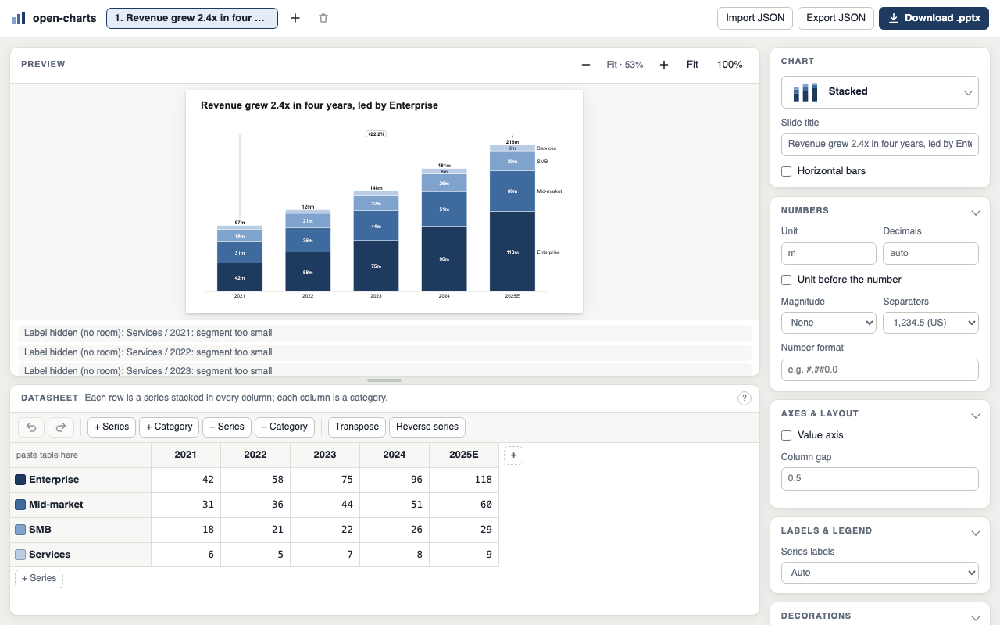

# open-charts

open-charts adds consulting-quality charts to PowerPoint, as native shapes you can edit. Pick a chart
type from the **open-charts** ribbon tab, type or paste your numbers into a datasheet, and it does the
layout work for you: axis scale, label placement, totals, CAGR and difference arrows, waterfall
connectors, shares that add up to exactly 100%. Each chart is one group of ordinary PowerPoint shapes,
so the deck opens and looks the same in PowerPoint, Keynote and LibreOffice with nothing installed,
and its data is stored inside the file so you (or a colleague) can edit it later. It is free and open
source (Apache-2.0). This first release is focused on one job: making charts in PowerPoint for Mac.
There is no AI and no connection to other apps.

There are three ways to use it: the **PowerPoint add-in**, the **web editor** (datasheet and live
preview, downloads a .pptx) and the **command line** (JSON in, .pptx out).

## Chart types

| | Type | What it's for |
|---|---|---|
|  | **Stacked** `stacked` | Composition over time, with totals, CAGR and difference arrows |
|  | **Clustered** `clustered` | Side-by-side comparison of a few series |
|  | **100%** `percent` | Mix and share; every column reads exactly 100% |
|  | **Waterfall** `waterfall` | Bridges such as an EBITDA walk, with subtotals and connectors |
|  | **Combination** `combo` | Columns with a line on top, e.g. actuals against plan |
|  | **Line** `line` | Trends; also as a step line |
|  | **Stacked area** `area` | Composition over time as filled bands |
|  | **100% area** `area100` | Mix over time as bands that fill the height |
|  | **Mekko** `mekko` | Market maps: column width is the segment's size |
|  | **Mekko XY** `mekkoxy` | Cost curves: width and height each carry a value |
|  | **Scatter** `scatter` | Two measures per item, labelled points |
|  | **Bubble** `bubble` | Portfolios: two measures plus size |
|  | **Pie** `pie` | A few shares of one whole |
|  | **Doughnut** `doughnut` | Shares with the total in the middle |
|  | **Harvey balls** `harvey` | Qualitative ratings of options against criteria |
|  | **Table** `table` | Financial summaries and comparison tables in native shapes |
|  | **Gantt** `gantt` | Roadmaps and project plans with milestones, phases and a today line |

The [user guide](docs/USER-GUIDE.md#chart-types) explains when to use each one and how to enter its
data.

## Install

You need:

- **A Mac with PowerPoint for Mac** (Microsoft 365 / version 16; tested on 16.105) for the add-in.
  The web editor and the command line run anywhere Node runs.
- **Node.js 22.6 or newer.** Check with `node --version`; install it from
  [nodejs.org](https://nodejs.org) if needed.
- **This repository**, downloaded or cloned to your Mac.

Then, in Terminal, from the repository folder:

```sh
npm install
node --experimental-strip-types --no-warnings src/cli.ts addin install
```

open-charts itself has no runtime dependencies; `npm install` only sets up the test tools.
`addin install`:

1. copies the chart engine to `~/Library/Application Support/open-charts/engine`;
2. writes the add-in to `~/Library/Application Support/Microsoft/open-charts/open-charts.ppam`;
3. installs the small bridge script PowerPoint uses to reach the engine
   (`~/Library/Application Scripts/com.microsoft.Powerpoint/open-charts.scpt`), with the path of the
   Node that ran the install;
4. installs the `open-charts` command: a launcher at
   `~/Library/Application Support/open-charts/bin/open-charts` that runs this folder, linked into
   `~/.local/bin`, `~/bin`, `/opt/homebrew/bin` or `/usr/local/bin` when one of them is on your PATH
   and writable (otherwise the install prints the line to add to `~/.zshrc`);
5. registers and loads the add-in in PowerPoint (it starts PowerPoint if needed).

Look for the **open-charts** tab, before Home. If PowerPoint asks about macros for
`open-charts.ppam`, click **Enable Macros**: the add-in is a small macro file that passes your clicks
to the engine and draws the shapes it returns. The first time you apply data from the datasheet,
macOS asks once: *"Microsoft PowerPoint" wants access to control "Microsoft PowerPoint"*; click
**Allow** (until you do, Apply cannot update the slide).

Options and related commands:

| Command | What it does |
|---|---|
| `open-charts addin install --no-register` | Install without touching PowerPoint; then load it yourself: *Tools › PowerPoint Add-ins…*, **+**, pick the `.ppam` above. |
| `open-charts addin uninstall` | Unload the add-in and remove the installed files and the `open-charts` command. |
| `open-charts addin build [-o dist/open-charts.ppam]` | Only build the `.ppam` file. |
| `open-charts addin types` | List the chart types in the ribbon menu and whether each is available. |

Run `open-charts addin install` again after you update open-charts or move or upgrade Node. If
`open-charts` is not on your PATH, the full form always works (this is what the add-in's messages
show):

```sh
"$HOME/Library/Application Support/open-charts/bin/open-charts" addin install
```

Without the add-in (Linux, Windows, or before installing), use
`node --experimental-strip-types --no-warnings src/cli.ts` from the repository folder wherever this
README says `open-charts`, or run `npm link` there once to put `open-charts` on your PATH.

## Quick start in PowerPoint

1. **Insert.** Click a slide, open the **open-charts** tab and choose **Insert chart** › a type. The
   chart arrives with sample data, in the slide's empty content placeholder if it has one.
2. **Edit data.** With the chart selected, click **Edit data**. The datasheet opens in your browser:
   type or paste from Excel, and watch the preview.
3. **Apply.** Click **Apply to slide** (⌘↵). The chart on the slide is redrawn in place. Keep the
   window open to apply again, or **Cancel**.
4. **Resize.** Drag the chart's handles. When you click elsewhere it is laid out again for the new
   size: text keeps its size, labels are re-placed. **Update chart** does the same on demand.

The [user guide](docs/USER-GUIDE.md) covers the datasheet, every option, hidden labels and
troubleshooting.

### Agenda

The **Agenda** group on the same tab builds chapters: **Chapter** inserts an agenda slide (a new
chapter) after the current slide, **Table of Contents** a contents slide. Rename a chapter by typing
over its heading on any agenda slide, nest it with PowerPoint's list-level buttons, move it with
**Move up/down** (its slides move along), and split off a backup with **Split Agenda**: every agenda
slide follows, and a chapter with no slides of its own before its first subchapter has its agenda
slide hidden in the slide show. From the command line, `{"chapter": "Market"}` slides do the same
(`examples/agenda.json`). See the [user guide](docs/USER-GUIDE.md#agenda).

## Office.js add-in (Windows, web, Mac)

A second, web-based add-in runs wherever PowerPoint runs Office add-ins (Windows, the web, Mac): a
task pane with the same datasheet, the chart engine running inside the pane (no Node, no macros, no
data leaves the computer). It shares the `.ppam` add-in's tag contract, so a chart made by either
add-in, by the command line or by the web editor can be edited by the other.

```sh
npm install
npm run build:officejs      # dist/officejs: task pane, engine bundle, manifest.xml, fonts
npm run officejs:cert       # once: a certificate for https://localhost:4175 — trust it as printed
npm run officejs:serve      # keep running while you use the add-in
npm run officejs:sideload   # Mac: copies the manifest into PowerPoint's add-in folder; restart PowerPoint
```

Then **Home › open-charts** opens the pane: **Insert on slide** draws the chart on the current slide;
select an open-charts chart and the pane loads its data, **Apply to slide** replaces it in place,
**Revert** puts back the previous version, and a banner offers **Re-layout to new size** after a
resize. Sideloading on Windows and the web, and how charts are drawn on PowerPoints with fewer API
features, are in the [user guide](docs/USER-GUIDE.md#officejs-add-in-windows-web-mac).

## The editor

```sh
node --experimental-strip-types --no-warnings src/cli.ts serve     # then open http://localhost:4173
```

The same datasheet as **Edit data**, for a whole deck: chart type gallery, Excel-like datasheet
(ranges, paste from Excel, undo, context menu), options grouped by *Chart · Numbers · Axes & layout ·
Labels & legend · Decorations*, a live preview that lists any hidden label, and **Download .pptx**.
`--port` changes the port.



## The command line

```sh
node --experimental-strip-types --no-warnings src/cli.ts examples/deck.json -o out/deck --svg
```

| Command | What it does |
|---|---|
| `open-charts <deck.json> [-o out/deck]` | Writes `out/deck.pptx`, one chart per slide, plus agenda slides (`chapter`, `toc`, `split`). A file holding a single chart works too. |
| `  --svg` | Also writes `out/deck-<n>.svg` previews. |
| `  --strict` | Exit code 1 if any label had to be hidden (the deck is still written). |
| `  --report report.json` | Writes the layout issues per slide as JSON. |
| `  --font Arial.ttf --bold-font "Arial Bold.ttf"` | Measure text with these font files. |
| `open-charts inspect <deck.pptx> [--json]` | Lists the open-charts charts in a deck: frame, type, sizes. |
| `open-charts import <deck.pptx> [-o deck.json]` | Recovers the deck JSON from the charts in a .pptx. |
| `open-charts serve [--port 4173]` | Starts the web editor. |

Layout warnings (hidden labels) are printed to stderr.

## Data format

Every chart is a small JSON spec: a type, the categories (datasheet columns), the series (rows) and
options. A deck is a list of slides:

```json
{
  "slides": [{
    "title": "Revenue doubled in three years",
    "chart": {
      "type": "stacked",
      "categories": ["2021", "2022", "2023", "2024"],
      "series": [
        { "name": "Enterprise", "values": [42, 58, 75, 96] },
        { "name": "SMB", "values": [18, 21, 22, 26] }
      ],
      "options": { "unit": "m", "cagr": { "from": 0, "to": 3 } }
    }
  }]
}
```

Cells are numbers or `null`; a waterfall cell `"e"` marks a computed total; scatter and bubble cells
are `[x, y]` and `[x, y, size]`; Gantt cells are dates (`"2026-03-15"`, `"Mar 2026"`, `"Q2 2026"`);
table cells may be text. Options cover numbers (`unit`, `decimals`, `format`, `locale`, `scale`),
layout (`orientation`, `valueAxis`, `zeroBased`, `gap`, `seriesLabels`), decorations (`totals`,
`cagr`, `difference`, `totalsAt`) and chart-specific settings. Specs are validated with precise,
path-addressed errors (`/series/1/values/3: must be a number or null`).

Full reference: [docs/DATA-FORMAT.md](docs/DATA-FORMAT.md). JSON Schemas: `schema/chart.schema.json`,
`schema/deck.schema.json`. More examples: `examples/`.

## How it works

```
chart spec (JSON) → layout engine (src/core) → scene (exact shapes) → PowerPoint shapes / SVG preview
```

- **Engine.** The layout engine is pure TypeScript with no Office code. It measures text with real
  font metrics (Arial, or the metric-compatible Liberation Sans), so what it plans matches what
  PowerPoint draws. It decides every position and checks its own work: labels never overlap and
  nothing spills outside the chart area. A label that can't fit is hidden and reported, never drawn
  on top of something else.
- **Scene.** The result is a list of exact shapes (rectangles, lines, paths, text boxes), each with a
  role such as `bar:s0:c2` or `label:total:c3`. The PowerPoint writer, the add-in and the SVG preview
  all draw the same scene, so the preview always matches the slide.
- **Native shapes + tags.** Each chart becomes one PowerPoint group of plain shapes. The group carries
  tags: `OC_SPEC` (the chart's JSON spec), `OC_FRAME` (its box), `OC_FONT`, and version tags.
  Because the spec travels inside the deck, a chart stays editable: Edit data reopens it, resizing
  re-lays it out, and `open-charts import` recovers the JSON.
- **Add-in.** `open-charts.ppam` holds the ribbon and one small macro module with no chart logic. It
  sends each request to the engine through an AppleScript bridge (the route PowerPoint's sandbox
  allows) and draws the shapes it gets back. Edit data opens the datasheet from a local server on
  your Mac (`127.0.0.1:4174`); nothing leaves your machine.

Charts are laid out again whenever they are resized, so every chart must hold up at any size. Text
never shrinks below 8 pt: labels that do not fit are hidden and listed in `scene.hidden` (and fail
`--strict`); time axes thin to every 2nd, 3rd, … label; series names move to a legend when the frame
is narrow. Below a chart type's minimum size (`minimumSize()` in `src/core/minsize.ts`, e.g.
200 × 120 pt for columns, more for many categories, long names or wide tables) the chart is drawn as a
"too small" placeholder that says how large to make it. `test/resize.test.ts` checks every sample and
example at 40 sizes from 160 × 90 to 1400 × 800 pt; `npm run bench` reports layout and start-up times.

## Tests

```sh
npm test                # unit tests, zero dependencies (includes the docs examples, test/docs.test.ts)
npm run e2e             # editor end-to-end in Chromium (npm install; npx playwright install chromium)
npm run goldens         # examples → .pptx → LibreOffice PDF → PNG, diffed against test/goldens/<platform>/
npm run e2e:powerpoint  # macOS + PowerPoint: insert/update every chart type through the add-in
npm run e2e:agenda      # macOS + PowerPoint: chapters, nesting, moves, split, sorter, hidden slides
npm run bench           # layout and start-up times against the performance budgets
npm run build:officejs  # Office.js add-in bundle; test/officejs.test.ts and test/e2e/officejs.spec.ts test it
npm run officejs:live   # macOS + PowerPoint: the Office.js pane's self-test in real PowerPoint
```

`npm run goldens` needs `soffice` (LibreOffice) and `pdftoppm` (poppler). Baselines are per platform
because fonts render differently; `-- --update` rewrites them after you have reviewed
`out/goldens/actual/`, and failures write red-on-grey diffs to `out/goldens/diff/`. CI runs unit
tests and E2E on every PR, goldens nightly.

## Licence and provenance

Apache-2.0. Built from public chart-design conventions, published algorithms (Heckbert and Talbot et al. for axis ticks, largest-remainder rounding, Liang–Barsky clipping), the open OOXML standard and study of how existing charting tools behave. All code is original; none is copied from a commercial product. `vendor/opentype.module.js` is opentype.js (MIT). `vendor/fonts/LiberationSans-{Regular,Bold}.ttf` are the Liberation Sans 2.1.5 fonts (SIL Open Font License 1.1, `vendor/fonts/LiberationSans.LICENSE`), used by the Office.js add-in to measure text with Arial's widths.
