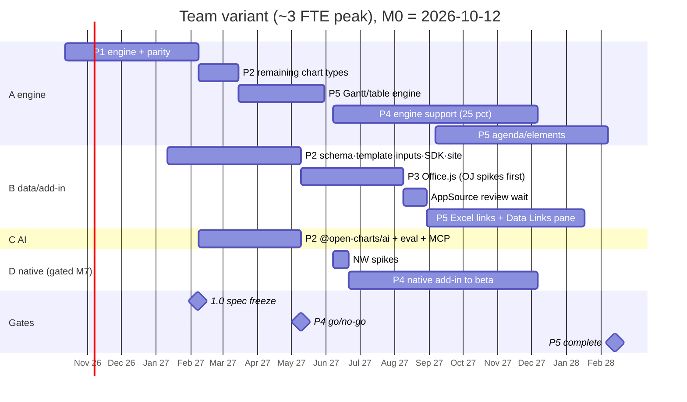
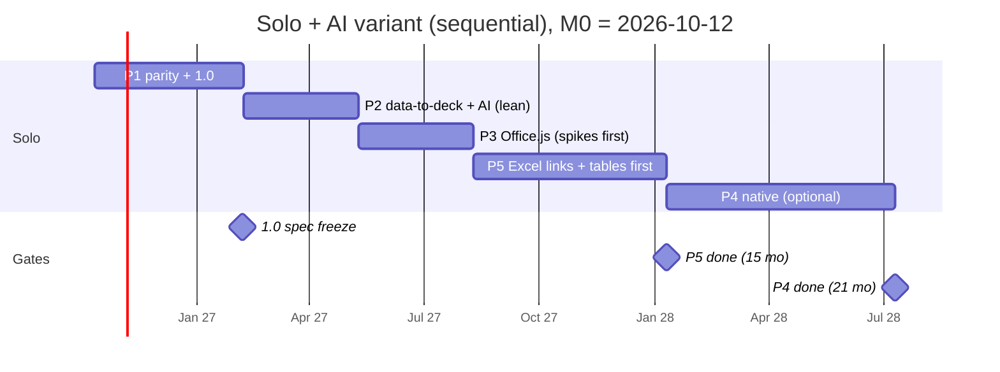

# open-charts — Master Plan

Status: synthesis of `docs/plan/01–04` and `docs/native-windows-design.md` as of commit `208b368` (+ uncommitted Mekko work), 2026-10-09. This document is the single entry point; the section docs (§11) hold the detail. Where section docs disagree, this document decides and says so (§4.2).


## 1. Vision and positioning

open-charts is an Apache-2.0 engine that turns a JSON chart spec into consulting-quality PowerPoint charts — stacked, waterfall, Mekko, line and the rest — as native, editable, grouped shapes with the label placement, totals, growth arrows, rounding and number-format conventions that consulting and corporate-finance users are trained on. On *chart quality* the bar is parity: a reviewer who uses the established native add-ins weekly cannot tell our slide from theirs. On everything around the chart we leapfrog rather than copy: the spec, not an opaque binary blob, is the source of truth (diffable, embeddable in the .pptx, recoverable); the pipeline is code-first (CLI, HTTP, TypeScript and Python SDKs, MCP server) with the editor and add-ins as thin surfaces over one engine; it is AI-native (the model chooses what to say with the data, the engine does every number and every pixel, and a verifier guarantees no number is invented); the layout checks itself with a machine-readable quality gate so unattended generation of hundreds of slides is safe; and it is cross-platform from day one — Windows, Mac, web and iPad through Office.js, with a native Windows add-in only for on-slide direct manipulation. No tiers, no licence keys, no hidden workbooks, no vendor data.

## 2. Current state (honest)

| Area | State | Evidence |
|---|---|---|
| Engine `src/core` | ~1,050 lines pure TS, zero deps, scene-first, real font metrics (opentype.js, kerning off, Arial line height 1.149), Heckbert/Talbot ticks, largest-remainder rounding, Liang–Barsky label/line hits | `src/core/*.ts` |
| Chart types | ✅ stacked, 100 %, clustered column; ✅ line; ✅ waterfall (running sum, totals/subtotals, connectors, below-zero bridges, `ee50240`); ✅ Mekko % and unit (`98f2913`) | `git log` |
| Decorations | ✅ totals, CAGR arrow (explicit `years` option; index-distance fallback), total-difference arrow, right-hand series labels, one-row legend, value axis, contrast text | `column.ts` |
| Renderers | ✅ dependency-free OOXML writer (one flat `grpSp`, alt text), ✅ SVG mirror, ✅ zip writer (no timestamps) | `src/render` |
| Surfaces | ✅ CLI (`deck.json → .pptx`, `--svg`), ✅ local editor (datasheet, Excel paste, live preview, download), ✅ `serve` | `src/cli.ts`, `src/server.ts`, `src/web/editor.html` |
| Tests | 20 passing (`core`, `waterfall`, `mekko`); `npm test` fixed (`test/*.test.ts` glob); `bin` fixed | `package.json` |
| Docs | README, 4 plan sections, native design, `tasks/todo.md` (stale: lists waterfall/line/100 % as open) | `docs/` |
| Not started | spec versioning/schema, scene ids/roles, label solver, ledger, theme files, `schemeClr`, tags in writer, bench harness, golden images, Windows CI, browser bundle, add-ins, template fill, inputs, AI, SDKs, docs site | — |

**Known bugs still open** (numbering from doc 02 §0.1; B1, B2, B4, B6 fixed in `a4c9f10`):

| # | Bug | Severity |
|---|---|---|
| B3 | CAGR falls back to category-index distance; no date parsing / 30/360 day count | H (quarterly data gives 4× CAGR) |
| B5 | Clustered: `null` drawn as a 0.01 pt bar labelled "0" | M |
| B7 | Line height is a constant for Arial, not read from `hhea`/`OS/2`; wrong for other fonts | M |
| B8 | Single word wider than slot / CJK cannot wrap; overflow undetected by gate | M |
| B9 | Legend is one row, never wraps; out-of-frame only reported | M |
| B10 | Data lines found by `width === 2`, not by role | L (latent) |
| B11 | Right-hand series names ignore side-placed point labels | L |
| B12 | Gate checks text×text and text×frame only (no text×mark, shape×frame, arrow×label) | H (parity blocker) |
| B13 | `hidden:` issues filtered out of test pass/fail; silent degradation never fails CI | M |
| B14 | `en-US` locale hard-coded; unit always suffix; no `$42`, `42 %`, `(42)`, magnitude scaling | H |
| B15 | Validation misses NaN/Infinity/strings/duplicates/bad hex; errors not path-addressed | M |

## 3. Architecture

One engine, one scene, one tag contract; every surface is a renderer or a host.

```mermaid
flowchart LR
  subgraph IN[Inputs]
    SPEC[ChartSpec / DeckSpec JSON<br/>specVersion 1]
    DATA[CSV · XLSX · Sheets<br/>src/inputs]
    AI[@open-charts/ai<br/>propose · explain · verify]
    TPL[Branded .pptx template<br/>src/template]
  end
  SPEC --> ENG
  DATA --> SPEC
  AI --> SPEC
  subgraph ENG[Engine src/core — pure TS, no I/O]
    direction TB
    M[migrate → validate] --> MOD[model] --> RES[reserve ledger] --> PLOT[plot] --> DEC[decorate] --> LAB[label solver] --> VER[verify gate] --> FB[fallback]
    MEAS[Measurer: opentype.js · canvas · DirectWrite]
    THEME[Theme JSON]
  end
  ENG --> SCENE[(Scene graph<br/>nodes · ids · roles · layers<br/>+ explain data)]
  SCENE --> PPTX[OOXML writer<br/>nested grpSp · schemeClr · tags]
  SCENE --> SVG[SVG preview<br/>editor · playground · pane]
  SCENE --> OJ[Office.js add-in<br/>Win · Mac · web · iPad]
  SCENE --> NW[Native Windows add-in<br/>Jint · overlay handles]
  PPTX --> CLI[CLI · HTTP · TS SDK · Python · MCP · GitHub Action]
  TPL --> PPTX
  TAG{{Tag contract v1<br/>OC_V · OC_ENGINE · OC_SPEC · OC_FRAME · OC_FONT · OC_ROLE · OC_HIDDEN · OC_BASE · OC_LINK}}
  PPTX -.writes.-> TAG
  OJ -.reads/writes.-> TAG
  NW -.reads/writes.-> TAG
  CLI -.inspect/import.-> TAG
  HND[handlesFor · applyDrag<br/>src/core/handles.ts] --> OJ
  HND --> NW
  ENG --> HND
```

Rules that keep this honest: `src/core` imports nothing outside itself and never touches fs/network/DOM (lint test); the editor and both add-ins consume `scene.json` and explain data and never grow layout logic; Python and the native add-in are wrappers/hosts of the same JS engine (never ports); native `c:chart` export is explicitly not planned.

**Engine pipeline contract** (doc 02 §1.3; each stage has a declared input/output so a chart plugin cannot reach around it — a new chart type is `model + reserve + plot + labels`, 150–300 lines):

| Stage | Owner | In → out | Shared or per-chart |
|---|---|---|---|
| 1 migrate | core | spec v0/v1 → current | shared, fixture-tested |
| 2 validate | core | spec → `{path, message}[]` (schema + semantic) | shared |
| 3 model | plugin | spec → numbers only: stacks, nets, running sums, domains, widths, ticks, **final formatted strings** | per chart |
| 4 reserve | plugin + decorations | claims on the ledger (axis width, legend rows, arrow rows) → plot rectangle (fixed point ≤ 6 rounds, Δ < 0.1 pt) | both |
| 5 plot | plugin | model → marks with owner + layer | per chart |
| 6 decorate | core | anchors → arrow/value-line/connector marks + `LabelRequest`s | shared |
| 7 label | core solver | requests + obstacle index → position or `hidden(reason)` with explain data | shared |
| 8 verify | core gate | scene → metrics (§9) | shared |
| 9 fallback | core | shrink one role one step (≥ `theme.fonts.min`) → re-run 7–8 → hide by priority → report | shared |

**Shared tag contract v1** — defined once in doc 03 §4.3; native §3 adopts it verbatim; doc 04 §A.1's "`OC_V` carries the spec version" is superseded (the spec version lives inside `OC_SPEC`). Rows marked *ext.* are native's additive v1 extensions, **decided unless objected**: ignorable by any host, no new keys needed to read a chart.

| Key | On | Value | Who writes |
|---|---|---|---|
| `OC_V` | group | `"1"` — **tag-contract** version (not engine, not spec) | all |
| `OC_ENGINE` | group | engine semver, for migrations | all |
| `OC_SPEC` | group | compact JSON `ChartSpec` (carries its own `specVersion`) + `{style?}`; chunked `OC_SPEC_0…n` + `OC_SPEC_N` above the measured limit | all |
| `OC_FRAME` | group | `"x,y,w,h"` pt | all |
| `OC_FONT` | group | measured font family | all |
| `OC_ROLE` | each child | `bar:s1:c2`, `label:total:c2`, `axis`, `arrow:cagr`, … | all |
| `OC_HIDDEN` | group | JSON `string[]` of roles the user deleted | add-ins |
| `OC_BASE` *ext.* | group | JSON `{role: {fill?, size?, bold?, color?}}` — last-*rendered* value of override-able props per role; ≈ 10 KB for 250 shapes, chunked like `OC_SPEC` if needed | native differ (three-way merge: current ≠ base ⇒ user override, kept and written into `OC_SPEC`); Office.js override read-back (03 §4.6) uses the same key |
| `OC_LINK` *ext.* | group | JSON `{path, sheet, range\|name, hash}` — mirrors `data.source` | P5 Excel links; others ignore |
| *(spec fields, not tags)* *ext.* | `OC_SPEC.options` | `labelOffsets: {role: {dx, dy}}`, `arrowLevel`, `axisMax` | written by drag handles (P4) and by the pane; plain `ChartOptions` additions in `src/core`, so CLI, editor and Office.js honour them |
| `OC_ROLE` = `frame` *ext.* | invisible rect child | add-in charts carry an invisible frame rectangle so the group's bounds equal `OC_FRAME`; bounds ≠ `OC_FRAME` ⇒ the user resized it ⇒ re-layout (2026-10-13) | add-in |
| *(engine output, not a tag)* *ext.* | `Scene.roles` | `string[]` parallel to shapes/nodes | the **engine assigns roles**, never a host; CLI writer, Office.js and native all emit `OC_ROLE` from it (lands with the scene graph in P1 week 3) |

Reading rules shared by all hosts: `OC_V` > known → read-only with a "made with a newer open-charts" banner; `OC_ENGINE` older → migrate spec on first edit and rewrite `OC_ENGINE`; `OC_FRAME` ≠ current group bounds → user resized/moved natively, offer re-layout. The tag-size limit is measured by **one** spike (OJ-S2; native's former S6 is the same spike).

## 4. Unified roadmap

### 4.1 Phase table

Effort = engineer-weeks (ew) of people who know the codebase; calendar = team variant (§5). Reviewer/community time listed separately.

| Phase | Goal | Key deliverables | Exit criteria (summary) | Effort | Calendar (team) | Depends on |
|---|---|---|---|---|---|---|
| **P1 Chart quality parity** | Six core types indistinguishable at 100 % zoom; engine becomes an engine | Commit Mekko; fix B3–B15; spec v1 + migrate + JSON Schema + path errors; scene graph (ids/roles/layers/nested groups); ledger; plugin pipeline; label solver v1 + fallback ladder; gate v2; numbers/locale/consistent rounding; theme JSON + `schemeClr`; horizontal bars + legend wrap; decorations (date CAGR, level/total arrows 3 modes, value lines, 100 % indicator, category gaps); waterfall/Mekko to bench quality; same-scale groups + two charts/slide; text (UAX 14, CJK stack); 22 bench fixtures + ≥ 40-slide golden gallery; LibreOffice goldens on PR; Windows PowerPoint golden runner nightly; CLI writes tags, `inspect`/`import`; behaviour-spec docs; editor polish (transpose, reverse, `100%=`); **1.0 + spec freeze** | Doc 01 §4 P1 (1–6) + doc 02 §4.5 gate (§9 here) | 18 ew eng + 8 reviewer-weeks | M0–M4 | — |
| **P2 Data-to-deck + AI** | A deck from data, in the user's template, from code or a model | Hand-written schema as source of truth + zero-dep validator; `fillTemplate` (OOXML read, named slots, byte-identical untouched parts); inputs (CSV/XLSX/Sheets, pivot); batch `--each`, `--strict`, `--report`, Docker, GitHub Action; `--stdio` + Python SDK + npm `dist/`; esbuild browser bundle + docs site with playground; remaining chart types (combo, area, secondary axis, axis breaks, date axis, pie/doughnut, scatter/bubble, butterfly, data tables, Harvey ball, checkbox); style files + sanitize; server mode; `@open-charts/ai` (proposeChart/Deck, explain, recommend rules-first, verifier, MCP server, 200–300-case eval) | Doc 01 §4 P2 (1–6); template fill byte-identical; AI KPIs §9 | 34 ew (data 17 · AI 12 · Python 3 · chart types 5 incl. in A's time) | M3–M7 (P5 engine-only items start M5.5) | P1 spec freeze (schema), scene ids (template slots) |
| **P3 Office.js add-in** | Insert, re-open, edit any element in PowerPoint on Windows, Mac, web, iPad | Spikes OJ-S1…S9; `core/text.ts` split; bundled Liberation metrics + canvas fallback; task pane = ported editor; Path A (`insertSlidesFromBase64`); Path B (scene → shapes, group, tags, `hostCaps` fallbacks); edit flow + resize banner + Revert; `OC_ROLE` override capture with diff preview; a11y, service worker, CSP/SRI, static hosting, centralized-deployment guide, AppSource submission | Doc 01 §4 P3 (1–5); pixel-identical to CLI; perf ≤ 1.5 s / 250 shapes | 14 ew (12 eng + 2 design) + 2–3 wk AppSource wait | M7–M10 (+M11) | P2 browser bundle, P1 tags |
| **P4 Native Windows direct manipulation** *(gated)* | Handles, context menus, live re-layout on Windows | Spikes NW-S1…S9; C#/.NET Fx 4.8 shared COM add-in; Jint engine host + opentype measurer (DirectWrite v1.1); `SceneDiffer` in-place three-way merge, one undo entry; WebView2 datasheet; calibrator + layered overlay + `WH_GETMESSAGE` hook + drag sessions (gap, width, labels, arrow row, axis); `handlesFor`/`applyDrag` in `src/core`; context menus, Ungroup/Regroup repurpose, contextual tab; per-user MSI, signing, updater, crash walls; automation harness + goldens + QA matrix; COM automation API | Doc 01 §4 P4 (1–5); ≥ 60 recorded interactions; 30 fps; fuzz 1,000 command sequences | 28 ew (22 .NET + 6 engine support) ± 30 % | M8–M14 | P3 edit flow + tags; go/no-go at M7 |
| **P5 Breadth** | The long tail: Gantt, agenda, tables, Excel links, elements | Gantt engine (calendar scales, rows, items, anchors, date formats) → editor → handles; agenda deck model (chapters ↔ slides, 12 style states); tables (auto-fit cells, content types, chart-linked); text boxes, chevrons, rounded rects; Excel live links (`data.source` snapshot/hash, `update`/revert/auto, Data Links pane, link frames, Excel add-in); consistent-rounding solver in Excel; process flows; RTL | Doc 01 §4 P5 (1–5) | 52 ew (2 engineers) | M5.5 (engine-only) / M10–M16 | P2 inputs, P3 pane |
| **Total** | | | | **≈ 146 ew ≈ 36 EM** incl. reviewer/community | **~17 months (±1)** | |

### 4.2 Reconciled estimates and inconsistencies

| Topic | Section docs said | Decision |
|---|---|---|
| P1 length | 01: 3 months. 02: 77 focused days incl. P2 types (items 1–15, 20–24 ≈ 55 d ≈ 11 focused wk). 04: 6 EM / 4 months incl. 0.5 reviewer | **4 months, 18 ew**. 11 focused weeks ≈ 17 calendar weeks at a realistic 65 % focus factor — the docs agree once units are aligned |
| P2 length | 01: +3 → +6 mo. 02: items 16–19, 21 ≈ 16.5 d. 04: 7.5 EM, 4 mo, overlaps P1 by 1 | **34 ew, M3–M7**; chart types (5 wk) done by the engine engineer after P1 |
| P3 length | 03: ~12 ew. 04: 3.5 EM ≈ 15 wk incl. designer | **14 ew + AppSource wait**; 03 is authoritative for scope |
| P4 length | native: 22 wk ± 30 % (+4 later). 01: +9 → +15 mo. 04: 7.5 EM ≈ 32 wk | **28 ew** (22 + 25 % engine engineer over 6 months), **6 months calendar**; the ±30 % is real — budget the upper bound |
| P5 length | 04: 12 EM / 6 mo / 2 engineers. 02: Gantt engine 8 focused days | **52 ew**; 02's 8 days is the *layout* of Gantt only; editor, handles, Excel links dominate |
| Total | 01: 18 mo. 04: 36.5 EM, ~18 mo | **36 EM, ~17 months** with the staffing in §5 |
| Spec version field | 02: `"version": 2` (today = v1). 04: `specVersion: 1` optional, 0.x until P1 | **`specVersion`** at deck and chart root. Today's unversioned spec is **v0**; the restructured spec (decorations list, `orientation`, `labels`/`axis` objects) ships as **v1** and freezes at P1 exit = **1.0**. `migrate()` upgrades v0 forever |
| Schema source of truth | 02: generated from TS types. 04: hand-written, TS mirrors it | **Hand-written JSON Schema 2020-12** + zero-dep validator + "kitchen-sink" sync test (ajv dev-only). Keeps the no-dependency promise |
| `OC_V` meaning | 03 table: contract version. 03 code sample and the *original* native §3: engine version. 04: spec version | **Contract version** (§3); native §3 now adopts 03 §4.3 verbatim. Engine → `OC_ENGINE`; spec version lives inside `OC_SPEC` |
| `OC_FRAME` format | 03 code: JSON. 03 table + native: `"x,y,w,h"` | `"x,y,w,h"` |
| Contract extensions | native proposes `OC_BASE`, `OC_LINK`, drag-written spec fields (`labelOffsets`, `arrowLevel`, `axisMax`) and engine-emitted `Scene.roles` | All four admitted to v1 as **additive, decided-unless-objected** (§3); hosts ignore unknown `OC_*`; roles are assigned by the engine only |
| When the CLI writes tags | 03: P3 milestone 3. native: P4 M1. 01: needed for P1 exit (`import` recovers spec) | **P1** (≈ 1 day) plus `open-charts inspect` |
| Line height | 02 B7: hard-coded 1.2. native: 1.2. code today: 1.149 constant | Still open: **read from font `hhea`/`OS/2`**, verify per family in the text-parity spike |
| Kerning (B6) | measure `kerning:false` vs emit `kern="1200"` | **Decided & done**: measure without kerning; writer never sets `kern` |
| Reference slide counts | 01: ≥ 40 golden gallery slides. 02: ~22 bench fixtures | Both: **22 bench fixtures** (engine CI) + **≥ 40 gallery slides** (human review) |
| Perf targets | 02: ≤ 60 labels < 5 ms, 50-slide deck < 2 s. 04: < 20 ms/chart, 100-slide deck < 2 s | **< 20 ms per chart p95 (≤ 60 labels < 5 ms), 100-slide deck < 2 s** |
| Blind panel | 02: ≥ 6 panellists, hit rate ≤ 60 %, rubric ≥ 4.3. 04: 5 panellists ≥ 4.0 | Release gate uses the **stricter** (02); 04's 4.0 is the per-type "parity" label during development |
| Hidden labels | 02: 0 on bench slides. 04: < 2 % on corpus | **0 on bench/gallery; < 2 % on 500-case fuzz** |
| Golden diff | 02: SSIM ≥ 0.995 + 8×8 block test. 04: < 0.5 % pixels | All three |
| Native engine host | 01: "embedded Node or TS→.NET bridge". native: Jint | **Jint**, ClearScript/V8 fallback if NW-S4 > 30 ms |
| esbuild introduction | 04: when the add-in starts (P3). 04 C.6 playground (P2) needs it | **P2** (playground), reused by P3 |
| Spike IDs | 03 S1–S9 and native S1–S9 collide; 03 S2 = native S6; 03 S7 ≈ native S9 ≈ 02 item 2 | Renamed **OJ-S*** and **NW-S***; tag-size spike and text-parity spike run **once** |
| Phase 4 in solo variant | 04: skip or +6 months | **Skip by default**; re-decide at the M7 gate |
| Native Mac add-in | 01: P6 question | Out of scope; Office.js is the Mac product |

### 4.3 Exit criteria in full

| Phase | Exit criteria (all must hold) |
|---|---|
| **P1** | (1) Golden gallery ≥ 40 slides (≥ 6/type) rebuilt from data; two consultants find no visible difference at 100 % zoom; issues logged to zero. (2) Gate green on every fixture: 0 overlaps, 0 out-of-frame, 100 % columns sum to 100, waterfall `e` columns balance, Mekko widths sum to plot width ± 0.5 pt. (3) Native round-trip in PowerPoint Win/Mac, Keynote, LibreOffice without repair; ungroup → regroup intact; `import` recovers the spec from tags. (4) Text metrics ± 2 % of PowerPoint for Arial/Liberation, Calibri, one `.potx` font. (5) Editor: Excel paste → preview < 200 ms → download; transpose, reverse, `100%=`, optional rows. (6) `specVersion: 1` frozen with JSON Schema; later breaking changes are migrations. (7) §9 release gate passed once. |
| **P2** | (1) `open-charts fill template.pptx data.json` replaces every named chart, text field, Harvey ball and checkbox in a 30-slide template preserving positions, styles, annotations; arrows recompute; untouched parts byte-identical. (2) A `style.json` reproduces a client deck's look for all P1 + P2 types; switching styles changes appearance only. (3) Recommendation ≥ 85 % on a 100-case benchmark; model path explains itself. (4) Action titles "usable with light edits" ≥ 80 % of gallery. (5) Scanner within 3 % on ≥ 90 % of bars across 50 images. (6) Server mode < 1 s/slide p95 in a container. (7) npm `dist/` + PyPI wrapper released together; docs site with playground live; AI eval nightly with 100 % numbers verified. |
| **P3** | (1) Insert and re-edit any P1/P2 chart from the pane on Windows, Mac and web; group pixel-identical to CLI output. (2) Update replaces in place (same z-order, position, name) preserving the user's move of the whole group. (3) Passes the AppSource validation checklist (even if only side-loaded). (4) Clean-up on a 200-slide deck < 10 s, every category removed. (5) Documented limits: no sub-shape handles, no segment context menu (deferred to P4). (6) OJ-S1…S9 answered; iPad pane-only pass; offline after first use on WebView2 (WKWebView per OJ-S8). |
| **P4** | (1) ≥ 60 mouse interactions from the reference manual's chart chapters, each in a recorded test. (2) Drag feedback ≥ 30 fps on a 2-year-old laptop; 12-series relayout < 50 ms. (3) Manual label placements, locked edges, dynamic alignments persist through data edits, save/reload and the Office.js path (shared tags). (4) Group/Ungroup/Regroup/Undo never corrupt; 1,000-sequence fuzz. (5) COM API with `PresentationFromTemplate`- and `UpdateBatch`-equivalents, VBA + C# samples. (6) `OnConnection` ≤ 150 ms; QA matrix (2016–2024, M365 Current/SAC, 32/64-bit, DPI 100/150/200 + mixed) green; signed per-user MSI with updater and crash walls. |
| **P5** | (1) Gantt: 15 reference timelines (quarter/month/week, milestones, brackets, shades, three label columns) indistinguishable; dates round-trip. (2) Agenda: insert/reorder/nest/split on a 60-slide deck; every agenda slide updates; hidden-parent logic matches. (3) Tables: 20 reference tables rebuilt; a chart-linked table stays in sync. (4) Excel links: create, link, update, revert, auto, alternate source, bulk dialog across a 50-element deck × 3 workbooks; link-frame colours correct. (5) Consistent rounding: rounded addends sum to rounded totals; unsolvable cases reported, never guessed. |

## 5. Critical path and timelines

**Critical path (team):** P1 engine (spec v1 freeze, scene ids, tags, text parity) → P2 data track (schema, template fill, browser bundle) → P3 Office.js (same engineer) → P5 add-in-side Excel links. It is the serialized chain of engineer B (M3 → M16). Shortening it needs a second TS engineer from M7 (≈ −3 months). P4 is off the critical path by design (gated). P1 itself is gated by the Windows golden runner (parity is only provable on Windows) — provision it in week 1.

**Hard dependencies (what blocks what):**

| Needed by | Needs | If missed |
|---|---|---|
| P2 template fill, SDK types, docs playground | P1 spec v1 freeze + scene ids/roles | Named slots and overrides have nothing stable to key on; SDK ships a moving API |
| P3 add-in (both paths) | P2 esbuild browser bundle; `core/text.ts` split; P1 tags in the writer | Add-in cannot run the engine or re-open CLI decks |
| P3 Path B per platform | OJ-S1/S4/S5 results | Design commits to APIs that are missing on Mac/web |
| P4 go/no-go (M7) | NW-S1/S2/S4 + P3 adoption KPIs | Six months and ~$100k+ spent on a feature nobody asked for, or on hooks that do not work |
| P4 handles | `handlesFor`/`applyDrag` in `src/core` (shared with the Office.js SVG preview) | Handle geometry diverges between hosts |
| P5 Excel links | P2 `data.source` snapshot design, P3 pane, `OC_LINK` | Links retrofitted into a frozen spec |
| Every "matches PowerPoint" claim | Windows golden runner (week 1–4) | Parity rests on LibreOffice and screenshots |

**Staffing (team variant, peak 3 FTE):** A = senior engine engineer (full project); B = TS data/tooling → Office.js → Excel links; C = AI engineer (3-month contract); D = senior .NET/Office engineer (P4, gated); R = chart-design reviewer 0.5 FTE in P1, 0.2 after; community/docs 0.2 FTE from P2.





Solo notes: AI tooling roughly doubles throughput on spec-driven engine/tooling work (P1, P2, P5) and helps little with Office integration (P3, P4) that needs machines, licences and manual testing. Recruit 2–3 ex-consultants as unpaid reviewers for the gallery review; the AI eval doubles as QA.

## 6. The first 30 days

Two tracks. Track E (engine) is the critical path and applies to both variants; Track S (spikes + infrastructure) is engineer B / a contractor in the team variant and only the starred items in the solo variant. Doc 02 backlog item numbers in brackets.

| Week | Track E — engine (A) | Track S — spikes & infra (B) |
|---|---|---|
| **1** (Oct 12–16) | Fix B5, B10, B13 and `tasks/todo.md`. `npm test` green from a clean clone in CI (GitHub Actions, Node 22 + 24). Text parity [2]: line height from `hhea`/`OS/2` (B7), bold face check, measurement LRU cache. Start `docs/behaviour-spec.md` (rule → source) | Order: Windows VM + 3 × M365 licences, Mac test machine, EV/Trusted Signing cert. **OJ-S2*** tag size & persistence (1/32/256 KB; copy/paste; Keynote/LibreOffice re-save). **OJ-S7*** browser measurer parity (Chromium + WebKit vs Node, bundled Liberation). OJ-S1 API-set matrix + manifest format on Win/Mac/web/iPad |
| **2** (Oct 19–23) | Numbers & locale service [3]: Excel-style format strings, locale table, unit prefix/suffix/space, parentheses, magnitude, consistent rounding across segments + total (closes B14; bench slide 4). Start spec v1 [4]: `specVersion`, `migrate(v0)`, hand-written JSON Schema, path-addressed validation (B15), decorations as a list | OJ-S3 undo granularity, OJ-S4 shape-creation perf (50/150/300), OJ-S5 settable props (arrowheads, rotation, roundRect, margins/wrap/autosize), OJ-S6 selection event + groups, OJ-S9 `insertSlidesFromBase64` theme mapping. **NW-S4*** Jint timing on a 250-shape chart (console harness, no Office needed) |
| **3** (Oct 26–30) | Finish spec v1 (v0 fixtures migrate byte-identically; schema published). Scene graph [5]: node ids, owners, roles, layers, nested groups, text runs, `path`; writer emits nested `grpSp` with names, `custGeom`; SVG mirrors. Engine emits `Scene.roles`; writer emits **tag contract v1** (`OC_ROLE` from engine roles); `open-charts inspect` reads it back | OJ-S8 offline/service worker (WebView2, WKWebView). Decisive native spikes **NW-S1** (hook sees/swallows mouse-down; pointer vs mouse), **NW-S2** (`PointsToScreenPixels` at 100/150/200 % + mixed DPI), **NW-S3** (owned layered overlay) — team variant only; informs the P4 budget line. Write `docs/plan/spike-results.md`; manifest decision (XML unless OJ-S1 shows unified covers Mac + iPad) |
| **4** (Nov 2–6) | Space-reservation ledger [6] (removes both 3-pass loops; identical output on fixtures). Plugin interface + pipeline [7]; split `column.ts` into model/reserve/plot/labels. Begin label solver v1 [8]: candidates table, cost function, greedy + improvement, obstacle grid | Windows golden runner skeleton on the VM (PowerShell COM `Slide.Export` → PNG → diff). LibreOffice golden pipeline in Actions (`soffice` → `pdftoppm` → SSIM + block test) [10, part]. First 10 bench fixtures with expected `scene.json`. Text-parity numbers: 50 strings vs PowerPoint `BoundWidth` for Arial/Calibri at 10–18 pt (NW-S9 ≡ item 2 check) |

**Day-30 checkpoint (must all hold):** B5/B7/B10/B13/B14/B15 closed; spec v1 + schema + migration merged; scene graph + tags in the writer; ledger + pipeline merged; solver v1 branch passing bench slides 1–5; CI green on PR (unit + scene goldens + LibreOffice goldens); Windows runner exporting PNGs; all nine OJ spikes and NW-S1/S2/S4 answered in `spike-results.md`; behaviour-spec has an entry for every rule the six types already implement.

Solo variant: Track E as written; from Track S only the starred items (OJ-S2, OJ-S7, NW-S4 — none needs Windows; OJ-S2 runs on Mac) plus the LibreOffice golden pipeline; defer the Windows VM to week 6–8 and the NW spikes to the M7 gate.

## 7. Decisions

### 7.1 Already made (do not reopen without an RFC)

| Decision | Where |
|---|---|
| Spec-first: JSON spec is the source of truth, embedded in the .pptx via tags, recoverable with `import` | 01 §5, 03 §4.3 |
| One engine in TypeScript; Python = wrapper over `--stdio`; native = Jint host; no ports | 04 A.2, native §2 |
| Zero runtime dependencies; opentype.js vendored and hashed; tooling only at the edges (`tsc`, `esbuild`) | 04 C.2, C.10 |
| Scene-first layout, both renderers read the same scene; no native `c:chart` export | 02 §1.5 |
| Measure without kerning; writer and add-in set `kern="400000"` on every run so PowerPoint never kerns (it kerns when the attribute is missing — found in the live add-in test, 2026-10-13) | 02 B6, code |
| Bundled Liberation metrics primary in the browser, canvas fallback, `.ttf` upload later | 03 §3.2 |
| Office.js: XML manifest first (pending OJ-S1), PowerPointApi 1.2 floor, feature-detect 1.3–1.5; Path A always ships; Path B per-platform via `hostCaps` | 03 §2, §4.1 |
| Native: C#/.NET Fx 4.8 shared COM add-in, no VSTO; Jint; thread-local `WH_GETMESSAGE` hook; ghost-preview drags; in-place diff, never delete-and-recreate on the hot path | native §1–5 |
| Tag contract v1 as in §3; `OC_V` = contract version; native's four additive extensions (`OC_BASE`, `OC_LINK`, drag-written options, `Scene.roles`) accepted unless objected | 03 §4.3, native §3, this doc |
| `specVersion` naming; v0 → v1 migration; 1.0 at P1 exit | this doc |
| Hand-written JSON Schema + zero-dep validator | 04 A.1 |
| AI split: model chooses *what to say*, engine does numbers/geometry; reference mode + verifier; separate `@open-charts/ai` package; rules-first recommendation | 04 B |
| Apache-2.0, DCO not CLA, BDFL to 1.0 then ≥ 3 maintainers from ≥ 2 orgs, RFCs for spec changes, ADRs with public sources | 04 C.7–C.8 |
| Out of scope: asset library, DAM/stock images, image element, Mekko Graphics import, licensed data providers, native Mac add-in | 01 §6 |
| Deliberate non-differences: copy the reference's visual conventions exactly (stagger rules, boxed labels, arrow geometry, `e` semantics, 30/360 CAGR) | 01 §5 |

### 7.2 Open — need the owner

| # | Decision | Options | Recommendation |
|---|---|---|---|
| **O1** | **Staffing variant and funding** | Team (36 EM, ~17 mo, $520–800k) · Solo + AI (15 mo w/o P4, ~$300–600/mo + legal) · Hybrid | **Hybrid**: solo + AI through P1 (4 months, proves parity, costs almost nothing), then hire B (TS) and C (AI contract) for P2–P3; decide D at the M7 gate |
| **O2** | **Build P4 (native Windows direct manipulation) at all, and on what evidence** | Always · Never · Gate | **Gate at M7** on: NW-S1/S2 green, P3 adoption ≥ 1k installs & 3 orgs on centralized deployment, and ≥ 30 % of add-in feedback asking for on-slide handles. Default **skip** in the solo variant |
| **O3** | **1.0 / spec-freeze timing** | P1 exit (M4) · P2 exit (M7) | **P1 exit**. P2 additions (`charts[]`, `from`, `data`) are additive within v1; freezing early lets add-ins and SDKs build on a stable contract |
| O4 | Windows golden runner now or later | Week 1 VM + licence · wait for P3 | Week 1 — a licensed VM is cheaper than a week of guessing text-box insets; parity is only provable there |
| O5 | Product name and trademark | Keep "open-charts" · rename | Run the clearance search in P1 (cheap); the name is in every URL and tag |
| O6 | Commercial model | Pure OSS · OSS + hosted HTTP service + model calls · paid add-in tier | OSS + optional hosted service only; **no paid offering before P3 and before the FTO search** |
| O7 | AI scope in P2 (solo) | Full B.2 surface · minimal (`proposeChart`, `explain`, MCP) | Minimal in solo; full in team variant |
| O8 | Manifest format | XML · unified JSON | XML unless OJ-S1 shows unified covers Mac + iPad on current channels |
| O9 | Jint vs ClearScript | — | Jint unless NW-S4 warm layout > 30 ms |
| O10 | Gantt start | P5 · engine-only in P2 when a contributor appears | P5 by default; accept an engine-only contribution earlier |
| O11 | Telemetry | None · opt-in anonymous counter | Opt-in only, off by default, disclosed |
| O12 | Docs-site stack | VitePress · plain static | VitePress (dev dep, `site/`), examples built by CI |

## 8. Consolidated risk register (top 12)

| # | Risk | L | I | Mitigation | Owner / phase |
|---|---|---|---|---|---|
| R1 | "Parity" is subjective; charts look *almost* right and users leave | H | H | Behaviour spec from public conventions *before* coding each chart; 22 bench + 40 gallery slides; blind A/B panel gate; ship the quality gate as a visible feature | A, R / P1 |
| R2 | Font metrics differ from PowerPoint for non-Arial fonts | H | M | Windows runner measures real widths per release; `hhea` line height; conservative fallback table; `.ttf` upload; DirectWrite measurer in native v1.1 | A / P1, P4 |
| R3 | Parity only provable on Windows; without the runner every claim rests on LibreOffice | H | H | Provision VM + licence in week 1 (O4); nightly PowerPoint goldens; edit-roundtrip test | B / P1 |
| R4 | Engine hosts drift (browser bundle, Jint, Python) | M | H | One engine; byte-identical scene goldens run in Node, Chromium, WebKit and Jint; wrappers never lay out | A / all |
| R5 | Office.js API gaps wider than believed (groups, margins, arrowheads) | M | M | OJ spikes before design commits; Path A always ships; `hostCaps` degradation per platform | B / P3 |
| R6 | Native input interception fragile across Office builds; coordinate mapping off by pixels | H | H | NW-S1/S2/S3 first; hook only while a chart is selected; "interpret native edits" fallback ships in M2 before the overlay; feature flags per machine; DPI matrix QA | D / P4 |
| R7 | Undo granularity (both hosts): one update = hundreds of Ctrl+Z | M | M | OJ-S3 / NW-S5 measure; minimal syncs; `StartNewUndoEntry`; in-pane Revert; honest docs | B, D / P3, P4 |
| R8 | Template fill corrupts a corporate deck | L | H | Byte-identical untouched-parts test; ECMA-376 validation; repair prompt = P0; `--dry-run` report | B / P2 |
| R9 | LLM invents or shifts a number | M | H | Reference mode by construction; token-level verifier; injection cases in eval; rejected specs never model-repaired; 100 % numbers-verified KPI blocks release | C / P2 |
| R10 | Patent exposure on label placement / linking / layout automation | L | H | FTO search before any paid offering; ADRs cite prior art; design-arounds recorded | owner / before O6 |
| R11 | Bus factor 1 / maintainer burnout | M | H | Governance plan at 1.0; "add a chart type in a day" docs; small zero-dep codebase; community 0.2 FTE from P2 | owner / P2+ |
| R12 | Platform churn (Node type stripping, manifests, Office APIs, AppSource) and tag-contract drift between hosts | M | M | Pin floors (Node ≥ 22.6, PowerPointApi 1.2, Office 2016+, .NET Fx 4.8); feature-detect; minimal manifest; one versioned tag doc + one shared fixture; AppSource off the critical path | B / P3+ |

Secondary (tracked, not top-12): solver plateau on dense scatter (seeded annealing behind a flag); scheme colours breaking SVG 1:1 (resolve at scene level); editor growing layout logic (lint); scope creep from the 152-feature inventory (phase table is the fence).

## 9. KPIs and the "indistinguishable quality" release gate

**Engine quality (every PR, hard gate):** zero overlaps (glyph-extent) and zero out-of-frame nodes on all bench fixtures, all themes, and a 500-case fuzz; 0 hidden labels on bench/gallery (unless fixture-declared), < 2 % on fuzz; rounding consistency (segments = total, 100 % columns = 100.0, CAGR label = recomputed ± 0.05 pp); alignment ≤ 0.25 pt; plot area ≥ 55 % (column) / 60 % (line) of frame; no run below 8 pt, no mixed sizes per role; deterministic (hash recorded); perf < 20 ms per chart p95 (≤ 60 labels < 5 ms; 200 labels < 50 ms), 100-slide deck < 2 s, editor keystroke-to-SVG < 30 ms; OOXML validator 0 errors, `python-pptx` loads, LibreOffice converts clean; test suite < 3 min on PR.

**Golden images:** LibreOffice on every PR; PowerPoint nightly + release: SSIM ≥ 0.995, no 8×8 block with mean abs diff > 24/255, < 0.5 % differing pixels at 2×. Baselines change only via `bench:accept` with a reviewed before/after report.

**Release gate — "indistinguishable" (P1 exit, then every minor release):**
1. All automated metrics above pass for all fixtures under all shipped themes.
2. PowerPoint goldens pass; LibreOffice goldens pass or carry an approved annotated difference.
3. Blind A/B panel: ≥ 6 weekly users of the reference add-in see 20 pairs (ours vs hand-built from the same JSON); pooled hit rate ≤ 60 % and no slide identified by ≥ 5/6.
4. Rubric (two blind reviewers, 1–5 on legibility/placement, proportion, typography, annotation clarity, "client-ready unchanged"): mean ≥ 4.3, no score below 3; any 1–2 is a blocking issue.
5. Editing test: a non-engineer changes a label and a colour in PowerPoint, regroups, saves — no repair prompt, no layout damage.
6. Native round-trip: opens in PowerPoint Win/Mac, Keynote, LibreOffice without repair; ungroup → regroup intact; `import` recovers the spec.
7. Text metrics within ± 2 % (± 0.5 pt on 30 strings) of PowerPoint for Arial/Liberation, Calibri and one `.potx` brand font.

**Data-to-deck & AI:** template fill byte-identical for untouched parts (100 %), < 1 s/slide; server mode < 1 s/slide p95; chart-type recommendation ≥ 85 % on a 100-case benchmark; AI eval ≥ 95 % schema-valid on first call, ≥ 90 % type-and-mapping match, **100 % numbers verified** (any failure blocks the AI package), title rubric ≥ 4/5 ("usable with light edits" ≥ 80 %); ≤ $0.03 per proposal; chart scanner ≥ 90 % of bars within 3 %.

**Add-ins:** inserted group pixel-identical to CLI output; ≤ 1.5 s per 250 shapes on Office web/Mac; ≥ 60 recorded interactions (P4); ≥ 30 fps drag; relayout of a 12-series chart < 50 ms; 1,000-sequence command fuzz with zero corruption; `OnConnection` ≤ 150 ms.

**Adoption & health:** P1 exit 500 stars, 1k weekly npm downloads, 10 external contributors; P3 exit 1k add-in installs, 3 orgs on centralized deployment; time-to-first-chart < 5 min; issue first response < 3 days, PR review < 7 days; monthly releases in 0.x; nightly golden/eval runs green ≥ 95 %.

## 10. Budget and IP notes

### 10.1 Budget

| Item | Team variant (17–18 mo) | Solo + AI (15 mo, no P4) |
|---|---|---|
| Engineering, 36 EM at $12–18k fully loaded | $440k–660k | developer's own time |
| Chart-design reviewer (~5 months part-time equiv.) | $30k–50k | unpaid ex-consultant reviewers |
| Community/docs 0.2 FTE × 14 mo | $25k–40k | — |
| AI API (evals, batch tests, dev use) | $4k–8k | in monthly run-rate |
| CI: Windows VM + 3 M365 licences + Mac test machine | $4k–6k | $300–600/month all-in (AI subscriptions + API, M365, CI VM) ≈ $5k–9k |
| Code signing (EV/Trusted Signing, Apple ID) | $1k–2k | $1k–2k (only if P4/notarised builds) |
| Legal: FTO patent search + opinion, trademark clearance + filing (US/EU), licence review | $15k–30k | $15k–30k, deferred until a paid offering or the name decision (O5/O6) |
| Domain, static hosting, AppSource (free), misc | $1k | $1k |
| **Total** | **≈ $520k–800k** | **≈ $20k–40k cash** |

Phase 4 alone is ~$95k–150k of the team budget and is the first line to cut (O2).

### 10.2 Approach and IP notes

- **How we build:** the most efficient and effective path to parity. We take inspiration from the reference product and from other information available on the internet — standards (ECMA-376/OOXML), academic papers (ticks, label placement, rounding), chart-design books, product manuals and marketing, our own experiments with PowerPoint/Keynote/LibreOffice, and the reference product's observed behaviour and internals (§12).
- **Behaviour spec:** every layout rule gets an entry in `docs/behaviour-spec.md` with its source, so decisions are traceable and reproducible.
- **Licensing:** Apache-2.0 for code, schema, docs (patent grant, defensive termination); opentype.js MIT with notice; Liberation Sans under OFL in the browser bundle only; Arial never redistributed; example data synthetic and CC0; DCO sign-off, no CLA.
- **Patents / trademark:** FTO search by counsel on automatic label placement, chart–spreadsheet linking, agenda/Gantt automation and consulting-style auto-layout *before any commercial offering*; design-arounds recorded privately; "open-charts" clearance in software classes US/EU, registration when the add-in ships, short trademark policy.

## 11. Index

| Doc | Covers | Read it for |
|---|---|---|
| [`plan/01-feature-roadmap.md`](plan/01-feature-roadmap.md) | 152-feature inventory scored by value/difficulty/surface/phase; phase definitions and exit criteria; leapfrog table; out-of-scope list | What is in each phase and why |
| [`plan/02-engine-and-quality.md`](plan/02-engine-and-quality.md) | Bug list B1–B15; spec v1 shape; scene graph; plugin pipeline; ledger; label solver (candidates, cost, optimisation); chart catalogue with edge cases; 22 bench slides; metrics; golden-image CI; human rubric; "indistinguishable" definition; 25-item ordered backlog | How to build the engine and prove its quality |
| [`plan/03-officejs-and-mac.md`](plan/03-officejs-and-mac.md) | Manifest, API requirement sets, browser engine build and font metrics, Path A/B insertion, tag contract, edit/re-layout flows, Mac specifics, distribution/offline/security, 6 milestones, spikes OJ-S1–S9 | The cross-platform add-in |
| [`plan/04-data-ai-and-engineering.md`](plan/04-data-ai-and-engineering.md) | Schema/validator/versioning, SDKs, template fill, inputs, Excel links design, batch/CI; AI integration, guardrails, eval; repo layout, build, test pyramid, golden CI, releases, docs site, governance, licence, security; team, solo variant, budget, risks, KPIs | Everything around the engine, and the money |
| [`native-windows-design.md`](native-windows-design.md) | COM add-in type, Jint engine host, DirectWrite, tag contract v1 (adopted from 03) + `OC_BASE` three-way in-place differ, calibrator/overlay/hook/drag sessions, undo/perf/threading, ribbon and context menus, WebView2 datasheet, packaging/resiliency, testing, 7 milestones, spikes NW-S1–S9 | On-slide direct manipulation on Windows |
| `plan/spike-results.md` (to be written, week 3) | Answers to all OJ-* and NW-* spikes | Go/no-go evidence |
| `behaviour-spec.md` (to be written, week 1) | Rule sources | Why each layout rule is what it is |
| [`../tasks/todo.md`](../tasks/todo.md) | Live checklist (stale — refresh in week 1) | Day-to-day tracking |

## 12. Reference-product internals (binary analysis, 2026-10-13)


### 12.1 How it's built (shape of the product)
- A single large C++ engine (~35 MB arm64) loaded **inside PowerPoint/Excel**, reaching the apps through an **OLE/COM automation compatibility layer** ported to macOS (private frameworks: COM/OLE/OLEAutomation/Uniscribe + a Windows-layer kernel). It drives Office via `IDispatch` and emits **native shapes**.
- Office loads thin **`.ppam`/`.xlam` VBA stubs** (an ~19 KB VBA module that only forwards). Every ribbon callback is a VBA sub with a **per-build random prefix** (e.g. `ARZ…`) that forwards the control id to the native engine in-process; a native `InitializeVbaRibbonHack` wires it up, version-aware (requires **Office 16.39+**).
- Six **out-of-process helpers**: updater, diagnostics, an OCR "chart-to-data" engine, a background services agent (stock-image panel + crash reports + push), a PowerPoint document handler, and an installer. IPC is CFMessagePort + Boost.Interprocess + JSON messages.
- **Build/third-party stack:** Boost 1.87 (Geometry, Multiprecision, Rational, UUID), COIN-OR CLP/CoinUtils (LP solver), Tesseract 5.5.3 (OCR), lunasvg, CommonCrypto. Useful signal for our own dependency choices (we stay zero-dep in `src/core`, but this shows what heavy lifting they needed).

### 12.2 Chart engine model (maps to our `src/core`)
- Data model is a typed tree: **DataTable → series-group → series → vector → scalar**, with `DataAxis`/`DataLabel`/`Legend` nodes. Element types via an `est…` enum (`LINE`/`AREA`/`SEGMENT`) and a datasheet layout `ect…` enum (`TABLE`/`STACKEDCOLUMN`/…). This is close to our spec→model stage; our `model` output (stacks, nets, running sums, domains, widths, ticks, formatted strings — §3 stage 3) is the right shape.
- **Layout is a linear program.** Global geometry (gridline-pair alignment, element size relations, Same-Size/Same-Width/Same-Height/fixed-size constraints) is solved with the **COIN-OR CLP simplex method** — not pure heuristics. Local decisions (individual label position, axis tick rounding, 1-D cases) use targeted solvers. **Implication for P1:** our **ledger + label solver v1** is on the right track; for the "same-scale groups / same-size" and gridline-alignment features, consider a small LP (or a constraint pass) rather than ad-hoc passes. This is a concrete design cue for the label solver and the reservation ledger (§3 stages 4,7; §4 P1).
- **Label placement = constrained candidate selection** (not free optimisation). Each label has an **allowed-position mask** over a fixed set — `CENTER`, `FREE` (user-dragged, pinned), `LEGEND`, and axis-relative `PRILOW`/`PRIHIGH`/`SECLOW`/`SECHIGH`. Auto-placement picks the **minimum-cost valid candidate** (no overlap, in-frame; collisions via Boost.Geometry polygons). **Directly informs our label solver v1** (candidates table + cost function + obstacle grid, §3 stage 7 / doc 02): adopt the same candidate enum + allowed-mask + min-cost model, and treat a user drag as switching a label to a pinned `FREE` state (mirrors our `labelOffsets`/`OC_HIDDEN` tags).
- **Axis:** "nice" rounding via a value-snapper + tick-spacing module (our Heckbert/Talbot ticks already cover this).
- **Waterfall specifics (confirms our model):** segment roles `WaterfallSummand`/`WaterfallFloating`, stacked fill order top-to-bottom/bottom-to-top, connector lines, difference/CAGR arrows, and sum-label positioning rules (`awayFromBaseline`/`accordingToSign`, avoid-segment-label-boxing). Our waterfall (running sum, totals/subtotals, connectors, below-zero) matches; the **sum-label position modes and "avoid boxing" rule** are worth adding to the behaviour-spec.

### 12.3 Storage format (why we leapfrog with spec-first)
- A chart is saved as **native shapes** + a **per-chart embedded Excel workbook** (`.xlsb`, BIFF records, in an OLE storage stream — their "Slide Workbook" / internal datasheet) + **custom XML** under a private namespace + **shape tags**. The engine re-recognises its own charts by **GUID + shape-name** (a persistent shape table). This is exactly the "opaque binary blob + hidden workbook" we reject — **our spec-in-tags (`OC_SPEC`) + recoverable `import` is the deliberate leapfrog** (§1, §3 tag contract). No change needed; this validates the positioning and the tag contract's role.
- **Data links** store an OOXML `externalLink` part **plus a cached copy** in the embedded workbook, refreshed on demand. Confirms our P5 `data.source` **snapshot + hash + on-demand update** design (§4 P5, `OC_LINK`).
- **Chart-to-Data (OCR):** screen-captures a chart image and reconstructs a datasheet with **Tesseract** + bar/rectangle detection. Matches our P2 "chart scanner ≥ 90 % of bars within 3 %" KPI — their approach (OCR + geometry) is a reasonable template.

### 12.4 Network, licensing, telemetry (reinforces "no tiers / no vendor data")
- **Licensing is key-based with an online check** (a hashed key sent to a backend, version-tagged). Editions are an entitlement bitset (only `CHARTS` edition flag was recoverable). Timing/offline/grace behaviour wasn't determinable statically. → Reinforces our **"no licence keys"** stance (§1) and O6 (OSS + optional hosted service only).
- **First-party usage telemetry exists** — a feature-counter enum covering every feature (insert-waterfall, stock-image searches, slide-workbook, …) **including a `USERCONFUSED` signal**; no third-party analytics SDK. Upload host not in the binary. → Reinforces **O11 (telemetry opt-in, off by default, disclosed)** as a genuine differentiator.
- **AI pane** is a WebKit web view that sends slide context to a **runtime-loaded** host (first- vs third-party **unprovable statically**) and supports external **MCP** tool servers. → Our AI design (model chooses *what to say*; engine does numbers/pixels; verifier; local-first) is a privacy leapfrog; flag "where does slide content go?" as the reference's weakest privacy point in positioning.
- **Admin controls** confirmed present as preference keys: auto-update + frequency, external error reporting. No explicit disable key for the usage counters or AI was found.

### 12.5 Net design cues for open-charts
1. **Label solver v1 (P1):** adopt the candidate-enum + allowed-position-mask + min-cost model; user drag → pinned `FREE`. (§3 stage 7, doc 02.)
2. **Global constraints (P1):** a small LP/constraint pass for same-size / gridline alignment beats ad-hoc multi-pass loops; the reference uses simplex for exactly this. Evaluate during ledger work.
3. **Waterfall/axis behaviour-spec:** add sum-label position modes, "avoid segment-label boxing", connector/arrow geometry notes.
4. **Excel links (P5):** externalLink-part + cached snapshot + hash matches our plan — proceed.
5. **Positioning:** keep "no licence keys, no hidden workbooks, no telemetry by default, AI that doesn't exfiltrate slide content" front-and-centre; all four are concrete contrasts with the reference's observed behaviour.
6. **Scope confirmations:** stay zero-dep in `src/core`; keep DAM/stock images and the embedded-workbook model out; spec-in-tags remains the core leapfrog.
