# open-charts user guide

This guide is for the people who build the slides: consultants, analysts, anyone who turns numbers
into a chart. It covers the PowerPoint add-in, the datasheet editor and each chart type. For the
exact JSON behind a chart, see [DATA-FORMAT.md](DATA-FORMAT.md).

- [The basics](#the-basics)
- [Working in PowerPoint](#working-in-powerpoint)
- [The datasheet](#the-datasheet)
- [Chart types](#chart-types)
- [Numbers: units, decimals, magnitudes, separators](#numbers-units-decimals-magnitudes-separators)
- [Decorations: totals, arrows, value lines, gaps and breaks](#decorations-totals-arrows-value-lines-gaps-and-breaks)
- [Colours and your deck's theme](#colours-and-your-decks-theme)
- [A client's look: style files](#a-clients-look-style-files)
- [Fill a template](#fill-a-template)
- [Two charts on a slide, same scale](#two-charts-on-a-slide-same-scale)
- [Resizing](#resizing)
- [Hidden labels and why](#hidden-labels-and-why)
- [Keyboard shortcuts](#keyboard-shortcuts)
- [Troubleshooting](#troubleshooting)

## The basics

An open-charts chart is a group of ordinary PowerPoint shapes: rectangles, lines, text boxes. Anyone
can open the deck, with or without open-charts installed, and it looks the same. What makes it a
chart rather than a drawing is the data stored inside the group: you can select it at any time, edit
its data and have it laid out again.

open-charts makes the layout decisions for you: where each label goes, whether it fits inside its
segment, how the axis is scaled, how the totals and growth arrows sit. If a label cannot be placed
cleanly it is **hidden and reported**, never drawn on top of something else.

## Working in PowerPoint

Install the add-in first (see the [README](../README.md#install)). You then have an **open-charts**
tab on the ribbon, before Home, with one group, **Charts**:

| Control | What it does |
|---|---|
| **Insert chart** | A menu of chart types, grouped *Column and bar · Line and area · Mekko · XY · Pie · Timeline and table*. Inserts the chart with sample data on the current slide. |
| **Edit data** | Opens the selected chart's datasheet in your browser. Click **Apply to slide** there and the chart on the slide updates. |
| **Update chart** | Lays the selected chart out again at its current size and position. |

Edit data and Update chart are greyed out unless an open-charts chart is selected.

### Insert, edit, apply, resize

1. **Insert.** Click a slide in Normal view, then **Insert chart** and pick a type. If the slide has
   an empty content placeholder, the chart takes its place and size; otherwise it goes in the
   standard chart area. The chart arrives with sample data.
2. **Edit data.** With the chart selected, click **Edit data**. A small datasheet window pops up
   next to the chart, with the first data cell ready for typing (see [Editing data](#editing-data)).
   Type or paste your numbers: the chart on the slide follows as you type.
3. **Done.** Press ⌘↵ (or click **Done**, or close the window) to keep the changes; **Esc** (or
   **Cancel**) puts the chart back as it was. The chart is redrawn in place, keeping its position and
   stacking order. Without the pop-up helper (see below) the datasheet opens in your browser instead:
   there you click **Apply to slide** (⌘↵) and the editor says **Updated on slide** once PowerPoint has
   done it (or why not, see [Troubleshooting](#troubleshooting)); **Cancel** (or Esc twice) closes it.
4. **Resize.** Drag the chart's corner handles like any shape. When you click elsewhere, open-charts
   lays the chart out again at the new size: text keeps its size, and the bars, labels and arrows are
   placed for the new space. Moving a chart only records its new position.

The first time Apply updates a slide, macOS asks once: *"Microsoft PowerPoint" wants access to
control "Microsoft PowerPoint"*; click **Allow**.

### Editing an existing chart

Select the chart (click it once) and click **Edit data**. This works on any open-charts chart,
including ones written by the command line or the web editor, and on decks you received from
someone else: the data travels inside the file. Don't ungroup the chart or edit its shapes by hand
if you want to keep editing its data: the next Update chart or Apply redraws the chart from its data
and replaces those changes.

## Office.js add-in (Windows, web, Mac)

The Office.js add-in is a second way to use open-charts in PowerPoint: a task pane instead of a
ribbon tab and browser window, with the chart engine running inside the pane. It needs no Node, no
macros and no AppleScript permission at run time, and works on PowerPoint for Windows, PowerPoint on
the web and PowerPoint for Mac. Both add-ins read and write the same data inside the chart (tag
contract v1), so a chart inserted by one can be edited by the other, and by the command line.

### Set it up

From the repository folder (Node 22.6+):

```sh
npm install
npm run build:officejs      # builds dist/officejs/ (task pane, manifest.xml, fonts, icons)
npm run officejs:cert       # makes a certificate for https://localhost:4175
npm run officejs:serve      # serves the add-in; keep it running while you use PowerPoint
```

**Trust the certificate once.** Office only loads add-ins over trusted https. `officejs:cert` prints
the command; on a Mac it is

```sh
security add-trusted-cert -r trustRoot -k ~/Library/Keychains/login.keychain-db \
  "$HOME/Library/Application Support/open-charts/officejs-cert/localhost.crt"
```

(macOS asks for your password; or double-click the file and set it to *Always Trust* in Keychain
Access). On Windows: `certutil -user -addstore Root localhost.crt`.

**Sideload the manifest** (`dist/officejs/manifest.xml`):

| Where | How |
|---|---|
| PowerPoint for Mac | `npm run officejs:sideload` copies it to `~/Library/Containers/com.microsoft.Powerpoint/Data/Documents/wef/`. If macOS asks whether Terminal may access data from other apps, click **Allow** (or copy the file there in Finder). Restart PowerPoint. |
| PowerPoint for Windows | Put the manifest in a shared folder, add the folder's `\\machine\share` path under *File › Options › Trust Center › Trust Center Settings › Trusted Add-in Catalogs* (tick *Show in Menu*), restart PowerPoint, then *Insert › My Add-ins › Shared Folder*. |
| PowerPoint on the web | *Insert › Add-ins › My Add-ins › Upload My Add-in*, pick the manifest. The browser must trust the certificate. |
| A whole organisation | Microsoft 365 admin centre › *Integrated apps* › upload the manifest, after `npm run build:officejs -- --base https://your-host/path` and hosting `dist/officejs/` there (any static https host). |

Then **Home › open-charts** opens the pane.

### Insert, edit, apply, revert

- **Insert.** With no chart selected the pane shows a sample chart and **Insert on slide**. Pick the
  type in the gallery, type or paste your data, and click **Insert on slide** (⌘↵): the chart is
  drawn on the current slide, in the standard chart area.
- **Edit.** Click any open-charts chart: the pane loads its data (the title reads *Editing …*).
  Change it and click **Apply to slide**: the chart is replaced in place — same position, size,
  name and stacking order — and stays selected.
- **Revert** appears after an Apply and puts back the chart as it was before it, one step per click,
  as long as the same chart stays selected. PowerPoint's own Undo also works, but may need several
  presses for one Apply.
- **Resize.** After you resize a chart, selecting it shows *This chart was resized* with
  **Re-layout to new size**, which lays it out again for the new size with its stored data (text
  keeps its size, labels are re-placed). Moving a chart needs nothing.

The preview, the issue list and every datasheet feature are the ones described below
([The datasheet](#the-datasheet)); in the pane they stack vertically.

### How the chart is drawn, by PowerPoint version

PowerPoint's add-in API grows with each version (`PowerPointApi` 1.4 … 1.10). The pane checks what
your PowerPoint offers and picks the best way to draw:

| Your PowerPoint offers | Columns, bars, waterfall, Mekko, scatter, table, Gantt | Lines, arrows, pie, doughnut, Harvey balls | Area charts |
|---|---|---|---|
| 1.10 (current Microsoft 365) | Shapes on the slide | Shapes on the slide (rotated lines and arrowheads, pie and arc presets) | Slide re-inserted with the chart |
| 1.8 – 1.9 | Shapes on the slide | Slide re-inserted with the chart | Slide re-inserted with the chart |
| 1.4 – 1.7 | New slide with the chart | New slide with the chart | New slide with the chart |

- **Shapes on the slide** (Path B): the chart is a group of native shapes, exactly as the `.ppam`
  add-in draws it.
- **Slide re-inserted** (Path A): area bands and other free-form shapes cannot be drawn through the
  add-in API, so the pane exports the slide, adds the chart to it with the same writer as the command
  line, inserts it after the original and removes the original. Everything on the slide is kept, but
  it becomes a new slide: links from other slides to it need re-pointing.
- **New slide** (Path A on older PowerPoints): Insert puts the chart on a new slide after the current
  one; Apply cannot replace a chart in place and says so.

The pane's first line in its log (`ready`) lists the API versions your PowerPoint has.

**Colours.** With 1.10 the chart is laid out in the slide's own theme colours; drawn as shapes they
are fixed colours, so after changing the deck's theme select the chart and Apply again. Charts drawn
through a re-inserted or new slide keep real theme colours.

**Your own formatting.** Apply redraws the chart from its data and its overrides (`overrides` in the
spec). Formatting you changed on the slide with PowerPoint's own tools (a bar's colour, a label's
size) is not read back by the pane yet and is replaced; the `.ppam` add-in keeps such edits.
Element overrides the pane cannot draw as shapes (pattern fills, theme fonts) send the chart through
the re-inserted slide.

**Fonts.** Text is measured with the bundled Liberation Sans, which has Arial's widths, so Arial
charts fit exactly. Charts in another font are measured as if they were Arial; labels may be a little
tighter or looser than planned.

### Troubleshooting the pane

**The pane is blank or says it cannot be reached.** Is `npm run officejs:serve` running? Is the
certificate trusted (open `https://localhost:4175/taskpane.html` in Safari: no warning should
appear)?

**The pane says "Open this pane from PowerPoint".** The page was opened in a browser, not through
Home › open-charts; it previews but cannot insert.

**Debugging on a Mac.** `defaults write com.microsoft.Powerpoint OfficeWebAddinDeveloperExtras -bool true`,
restart PowerPoint, right-click the pane › *Inspect Element*. The dev server also keeps the pane's log
at `https://localhost:4175/api/log` and in `~/Library/Application Support/open-charts/officejs.log`.

### Editing data

**Edit data** opens the datasheet in a small window that floats over PowerPoint, next to the chart
(to its right, or left, below or above when there is no room; inside PowerPoint's window when
PowerPoint cannot say where the chart is on screen). It opens in a fraction of a second: a small
helper app (*open-charts pop-up*, no Dock icon) keeps the datasheet loaded in the background while
PowerPoint runs.

- **Live.** Every change reaches the slide on its own, about 0.4 s after you stop typing. The status
  at the top says *Updating the slide…*, then *Updated on slide*. If you keep typing while PowerPoint
  draws, your later edits go in one more update with the latest numbers: PowerPoint is never asked to
  draw twice at once. A cell the chart cannot use (text in a number cell) is marked red and nothing
  is sent until it is fixed.
- **⌘↵ / Done / the window's close button** keep what is on the slide (sending your last edit first).
- **Esc / Cancel** put the chart back exactly as it was when the window opened, and close it.
- **Options** opens chart type and options over the datasheet. The slide itself is the preview, so
  the window has none. Copy, paste, undo, Tab and arrow keys work as in the full editor.
- The window stays with PowerPoint: it hides while another app is in front and comes back with
  PowerPoint. Drag it by its title bar; resize it from its edges.

**Selecting part of a chart.** Click a chart once to select it, then click a label or a bar inside
it: a small toolbar appears above the selection with the formatting that piece takes (today fill
colour, text size, bold, text colour and text direction, as each piece allows; more to come). A click there restyles
just those elements and redraws the chart; the change is stored in the chart's data, so it survives
Update chart, resizing and Edit data. The toolbar steps aside while you drag and hides when nothing
in a chart is selected. Telling the toolbar about a selection costs PowerPoint one short call (about
0.1 s) only when you select a different piece of an open-charts chart; other clicks cost nothing.

**Where it comes from.** `addin install` builds the helper on your Mac (with `swiftc` from Apple's
Command Line Tools: `xcode-select --install` if the install says it is missing) into
`~/Library/Application Support/open-charts/OpenChartsPopup.app`, ad-hoc signed (`codesign -s -`).
Because it is built on your Mac and never downloaded, macOS does not quarantine it and Gatekeeper does
not ask about it (`spctl --assess` says *rejected*, which only matters for downloaded apps). If you copy
a built helper to another Mac, the copy is quarantined and blocked: build it there instead
(`npm run build:popup`, then `addin install`), or clear the flag with
`xattr -dr com.apple.quarantine OpenChartsPopup.app`. If the helper is missing or does not start,
Edit data opens the datasheet in your browser as before, and nothing else changes.

**Windows.** Edit data opens the same pop-up as a borderless Microsoft Edge window (Edge ships with
Windows 10 and 11) next to the chart; without Edge it opens your default browser.

## The datasheet

The datasheet is the same in the add-in's **Edit data** window and in the standalone web editor.

- **Columns are categories** (years, regions, slices, activities). The header row holds their names.
- **Rows are series** (segments, lines, groups). The first column holds their names, with a colour
  swatch to change the series colour: a **theme colour** (Accent 1–6, which follows the deck's
  theme), one of the fixed accents, any hex colour, or **Automatic** (the next palette colour).
- A one-line hint above the sheet says what rows and columns mean for the current chart type.
- **Paste from Excel.** Copy a range in Excel and paste it into a cell: it fills the sheet from that
  cell, adding rows and columns as needed. Paste into the top-left corner cell to replace the whole
  table, with categories in the first row and series names in the first column. A single value
  pasted over a selected range fills every cell of it.
- **Numbers as you type them.** `1,234`, `(5)` (read as −5), `−3`, `$12` and `7%` are all
  understood; currency signs, `%` and spaces are dropped, so `7%` is stored as 7. Use the unit
  option to show `%` on the labels.
- **Empty cells** are allowed: nothing is drawn and no label is shown.
- **Text that isn't a number** (for the chart type) turns the cell red; the cell counts as empty and
  the message under it says what was expected. Validation errors from the engine also land on the
  cell they concern.
- **+ Series / + Category** add a row or column; **− Series / − Category** delete the one of the
  selected cell. Right-click a cell for insert left/right/above/below, delete, copy and clear.
- **Hide a row** (optional rows): click the eye left of a series name, or right-click a cell and
  pick *Hide series*. The row turns grey and striped, and the chart is drawn as if it were not
  there — totals, shares, the axis and the legend only count visible rows — but its numbers stay in
  the sheet and in the saved chart. Click the eye again to bring it back. The other rows keep their
  colours. At least one row stays visible, and rows a chart reads by position (a Gantt chart's Start
  and End, a Mekko XY chart's widths) always show. Pie and doughnut charts draw the first visible row.
- **Transpose** swaps rows and columns (rows it creates start visible); **Reverse series** flips the
  row order.
- **Undo / redo** work for everything: typing, pasting, options, type changes.
- **Chart type** is a gallery at the top of the options panel. Switching type keeps your data where
  the shapes match (numbers stay numbers). Switching between numbers, points (scatter/bubble) and
  dates (Gantt) converts what it can or starts from sample data.

The options panel on the right only shows what applies to the current chart type, in sections:
*Chart*, *Numbers*, *Axes & layout*, *Labels & legend*, *Decorations*. Every control has a tooltip.
A control you have not touched shows the chart type's default, which is what the preview draws
(totals are ticked on a new Mekko, the value axis on a new line chart). Switching type drops the
options the new type does not use.

Under the preview, problems are listed and numbered on the slide: click one to highlight the shapes
it concerns, or, for a hidden label, to jump to its cell.

### The standalone web editor

Run `open-charts serve` (see the README) and open http://localhost:4173. It works on a deck of
slides: add, duplicate and delete slides, give each an action title, then **Download .pptx**.
**Export JSON** saves the deck as JSON; **Import JSON** opens a deck or single-chart JSON file. Your
work is kept in the browser between visits. Every option of the
[data format](DATA-FORMAT.md#options) has a control in the panel.

## Chart types

Each section says when to use the chart, how to fill the datasheet and which options apply. The
images are rendered from `examples/`.

### Stacked column (`stacked`)

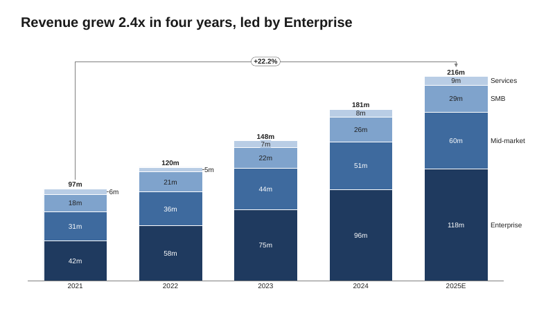

**Use it for** composition over time: revenue by segment, headcount by function.
**Datasheet:** each row is a segment stacked in every column; each column is a category.
Negative values stack downwards from the baseline.
**Options:** horizontal bars, value axis, column gap, series labels (right of the last column by
default, or a legend), totals (on by default), CAGR and difference arrows. Segment labels are
rounded so they add up exactly to the total shown on top.

### Clustered column (`clustered`)

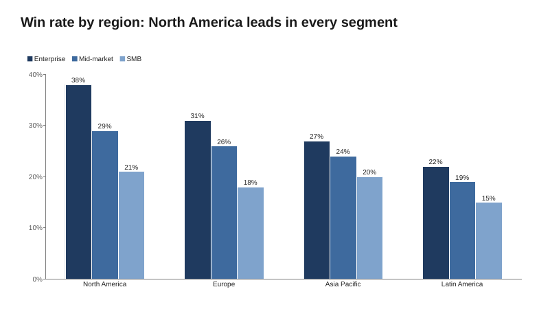

**Use it for** side-by-side comparison: win rate by region and segment.
**Datasheet:** each row is a series; its bars stand side by side in every category.
**Options:** horizontal bars, value axis, column gap, series labels (a legend by default). No totals
or arrows.

### 100% column (`percent`)

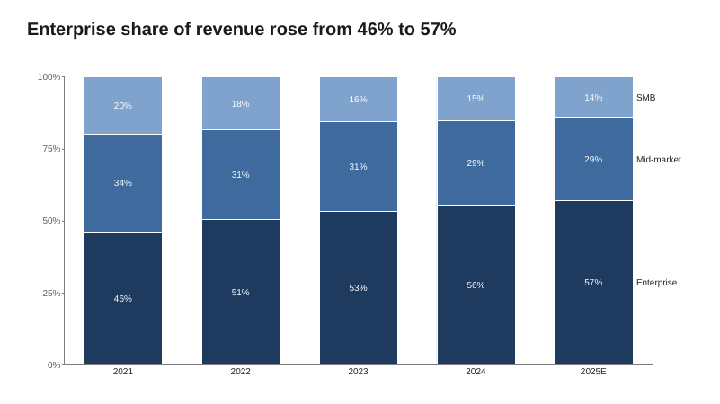

**Use it for** mix: share of revenue, channel mix.
**Datasheet:** each row is a series; every column is scaled to 100%. Shares are rounded so every
column reads exactly 100%. Negative values are ignored (and reported).
If your data is already in percent and a column may add up to less than 100% (survey answers with
no-replies), tick **Values are %**: each column then keeps its own total.
**Options:** horizontal bars, value axis, gap, series labels, totals (off by default; the raw column
totals), CAGR and difference arrows (on the raw totals). The add-in also offers **100% with % axis**,
the same chart with the value axis switched on.

### Waterfall (`waterfall`)

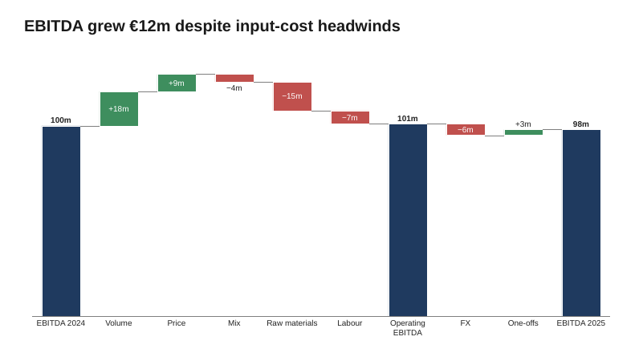

**Use it for** bridges: EBITDA walk, cash bridge, price-volume-mix.
**Datasheet:** the first row drives the bridge. Positive values step up (green), negative values
step down (red). The first category is the start value. To make a category a computed total, type
**`e`** in its cell: the column stands on the baseline at the running sum. Without any `e`, the first
and last categories are totals.
**Options:** **Total columns** (pick exactly which categories are totals; overrides `e`), value axis,
gap. With several rows, increases stack upwards and decreases downwards, each row in its own colour,
named in a legend.

### Combination (`combo`)

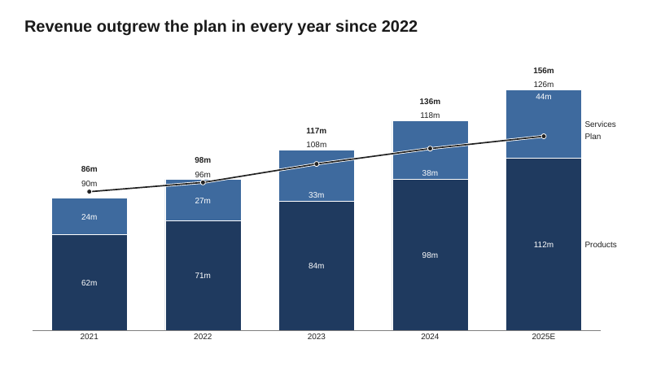

**Use it for** actuals against a plan or an average: columns with a line on top.
**Datasheet:** each row is a series. Under *Chart*, **Series drawn as lines** picks which rows are
lines (the last row becomes a line when you switch to this type). Lines share the columns' value
axis.
**Options:** columns stacked or clustered, value axis, gap, series labels, totals (stacked columns).

### Line (`line`), including step lines

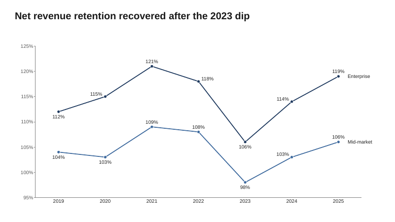 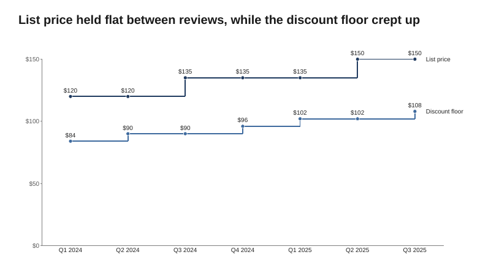

**Use it for** trends over time.
**Datasheet:** each row is a line; each column is a point on the category axis. Empty cells leave a
gap.
**Options:** **Step line** (holds each value until the next category), axis start (zero, or fit to
the data; by default the axis starts at zero unless the values sit in a narrow band far from it),
value axis (**on** by default for lines), series labels. Every point is labelled while the chart has
at most 24 points in total; beyond that only the last point of each line is labelled.

### Stacked area and 100% area (`area`, `area100`)

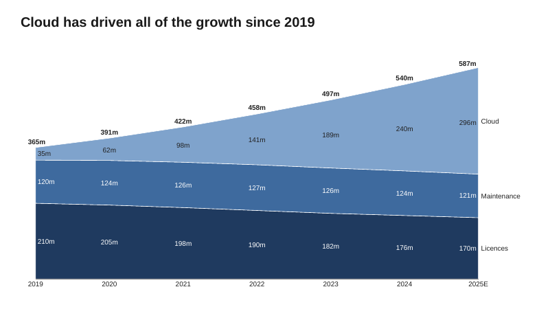 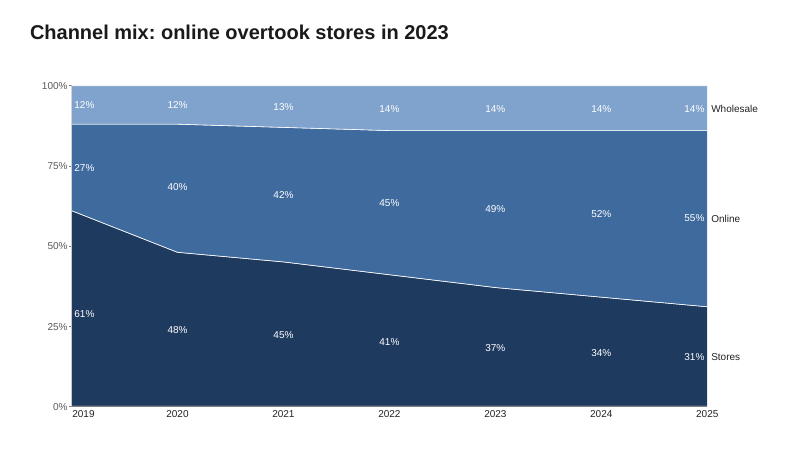

**Use it for** composition over time when the trend matters more than individual values.
**Datasheet:** each row is a band stacked on the ones above it; each column is a point. A missing
value is filled in from its neighbours (and carries no label); missing values at either end count as
zero. Negative values are ignored.
**Options:** value axis, series labels, totals above the top band (stacked area only). The 100% area
labels are rounded so each column reads exactly 100%.

### Mekko (`mekko`)

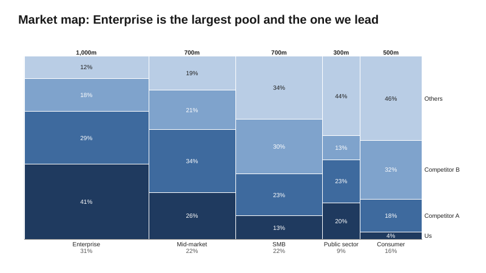

**Use it for** market maps: segment size as width, share within it as height.
**Datasheet:** columns are categories; their width is the column total. Rows are the segments.
Negative values are ignored.
**Options:** **Mekko heights**: *100% (share)* labels each segment with its share of the column;
*Absolute* keeps segment heights in units. Totals on top (on by default) and each column's share of
the grand total under its name. Value axis, series labels (switches to a legend when the last column
is too narrow).

### Mekko XY (`mekkoxy`)

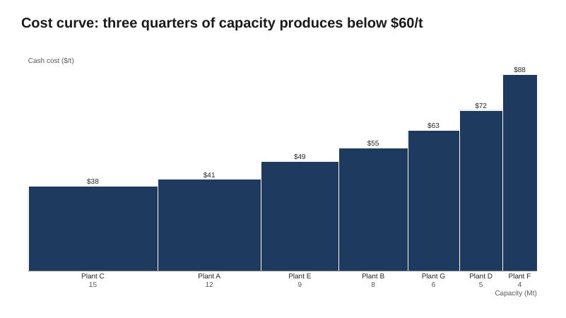

**Use it for** cost curves (capacity × cost) and spend per head (headcount × spend).
**Datasheet:** the first row is the column width (X extent); the rows below are stacked heights.
**Options:** **Order** (sheet order, reverse, ascending or descending height), value axis (also turns
the baseline into an axis of cumulative widths), totals, series labels.

### Scatter (`scatter`)

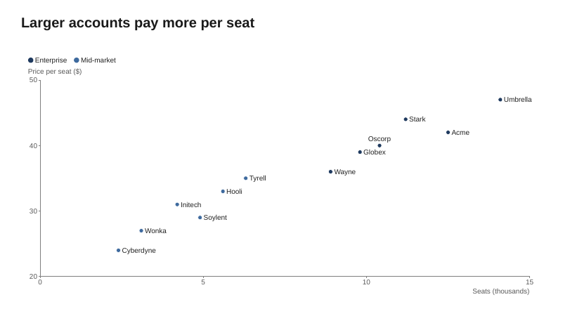

**Use it for** relationships between two measures: price vs. volume, accounts by size.
**Datasheet:** one point per column, labelled with the column name. Each cell is **`x; y`**, for
example `12.5; 42`. A row is a group with its own colour: put each point in the row of its group and
leave the other rows empty.
**Options:** X and Y axis titles, axis start. Groups are named in a legend when there are two or
more.

### Bubble (`bubble`)

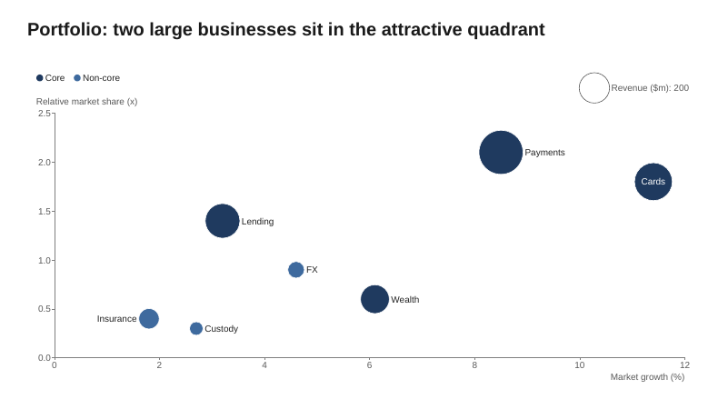

**Use it for** portfolios: growth vs. share, sized by revenue.
**Datasheet:** like scatter, but each cell is **`x; y; size`**. Bubble *area* is proportional to
size; small bubbles are drawn in front of large ones.
**Options:** axis titles, axis start; **Size legend** (a reference bubble of a round size, top
right) with an optional caption such as `Revenue ($m)`.

### Pie and doughnut (`pie`, `doughnut`)

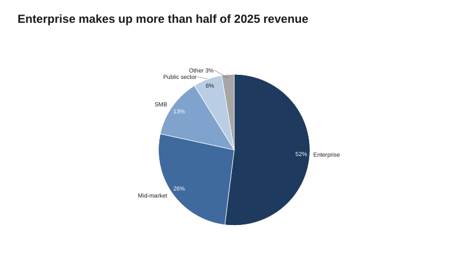 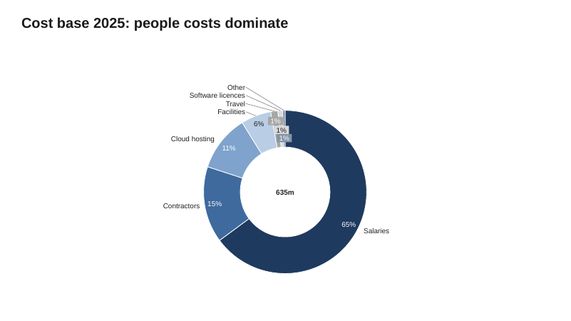

**Use them** sparingly, for a few shares of one whole.
**Datasheet:** only the first row is drawn: one slice per column. Negative values are ignored, zero
values get no slice.
**Options:** decimals (shares are rounded to add up to exactly 100%), series labels (category names
outside the slices, a legend, or none), totals (doughnut: the grand total in the hole). **Slice
labels** show the share (default), the value, or both (`118m (52%)`); values use the unit and
number options.

### Harvey balls (`harvey`)

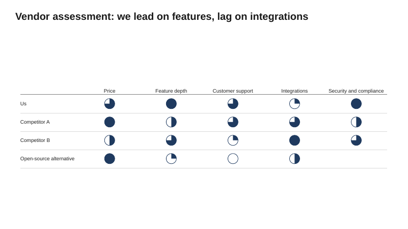

**Use it for** qualitative assessments: vendors against criteria, workstream status.
**Datasheet:** each row is an item, each column a criterion. Scores are quarters from 0 to 4. If all
scores are between 0 and 1 and at least one is a fraction, they are read as completion (0.6 = 60%
filled). Out-of-range scores are clamped and reported. Empty cells stay empty.

### Table (`table`)

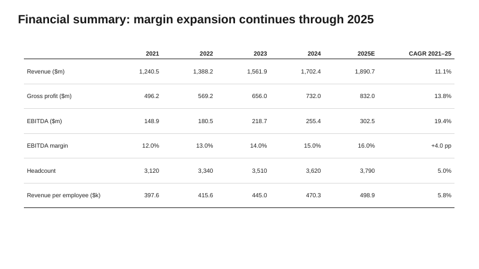

**Use it for** financial summaries and comparison tables built from native shapes.
**Datasheet:** rows become table rows, columns become table columns. Numbers are formatted with the
chart's number options; text cells (such as `+4.0 pp`) are shown as typed. Decimals are chosen per
row when the headers are periods (a financial summary), per column otherwise.

### Gantt (`gantt`)

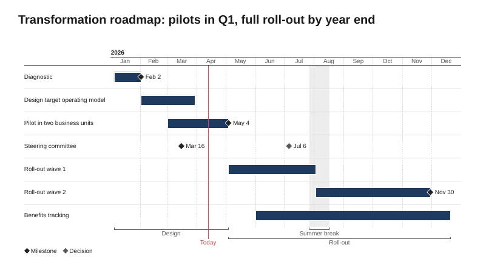

**Use it for** roadmaps and project plans.
**Datasheet:** one activity per column. The first row is **Start**, the second **End**: dates like
`2026-03-15`, `Mar 2026` or `Q2 2026`. Every further row is a kind of milestone (a diamond with its
date), e.g. "Milestone" and "Decision". An activity needs both a start and an end, or neither (a row
with only milestones). The end must come after the start. A date means the beginning of that day, so
a bar ending `2026-03-16` covers the 15th.
**Options:** the calendar scale (weeks, months, quarters, years) is picked to fit. Under
*Decorations*: **Today line** (a date; applied on Enter), **Shaded periods** (holidays, freezes)
and **Phase brackets**, each a list of from / to dates with an optional label (**+** adds one,
starting from the first activity's dates; **×** removes it). Separators
(locale) set the date style of milestone labels: US month-first, others day-first.

## Numbers: units, decimals, magnitudes, separators

The *Numbers* section applies to every label, total, arrow and axis tick of the chart:

| Control | Effect | Example |
|---|---|---|
| Unit | Text added to every value | `m` → `42m`; `%` → `42%` |
| Unit before the number | Puts the unit in front | `$` → `$42` |
| Decimals | Fixed digits after the decimal point (0–10); empty = automatic | `1` → `42.0` |
| Magnitude | Divides by a thousand, million or billion and adds k / m / bn; *Auto* picks one for the whole chart | 1,250,000 → `1.25m` |
| Separators | Decimal mark and grouping: US, UK, India (`12,34,567`), DE (`1.234,5`), FR (`1 234,5`) | |
| Number format | An Excel format code; overrides decimals; applied on Enter | `#,##0;(#,##0)` → `(480)` |

Automatic decimals use the fewest digits that show every value exactly (up to 2), so whole numbers
stay whole. Shares in 100%, Mekko and pie charts are rounded together so they always add up to
exactly 100%, and stacked segment labels add up exactly to their total. Negative numbers use a real
minus sign (−). See [DATA-FORMAT.md](DATA-FORMAT.md#numbers) for every detail of format codes.

## Decorations: totals, arrows, value lines, gaps and breaks

- **Totals**: the sum above each column. On by default for stacked, Mekko and Mekko XY charts;
  available on 100%, combination (stacked), stacked area and doughnut (in the hole).
- **CAGR arrow** (stacked and 100%): pick the two categories. The growth rate is computed from the
  column totals, over the number of years read from the category labels (`2021`, `FY24`, `Q1 2023`,
  `Jan 2024`, `2025E` all work), or, if the labels aren't dates, the number of columns between them.
  **Years** overrides that number (e.g. `2.5`); empty = automatic. Both totals must be positive;
  otherwise the arrow is left out and reported.
- **Difference arrow** (stacked and 100%): a bracket between two column totals. **Mode**: *Absolute*
  (↔, the signed difference; the default), *Relative* (→, the change in percent) or *Reverse* (←, the
  change in percent the other way).
- **Level arrows** (stacked, clustered, 100%, line): **+ Level arrow** adds a row: the two ends (a
  category and a series — the top of that segment, bar or point — or *Total* for the column total),
  the mode (relative by default) and where it sits: *Beside* the later column or *Between* the two.
  Dotted guides run from each level to the arrow; a short arrow gets its bubble beside it.
- **Value lines** (stacked, clustered, line): **+ Value line** adds a dashed line at a value or at
  *mean* (the average column total; a clustered chart's bars), labelled on the right or left, e.g.
  `Ø 27.8`, or with your own label (`{value}` inserts the number).
- **100% indicator** (100%): the "← 100%" marker beside the chart, on by default; right, left or none.
- **100%=** (100%): tick **100%= row** to add it to the datasheet: the value each
  column's shares are taken of. With **Values are %**, it is the absolute value behind 100%, and the
  totals show it.
- **Category gaps** and **Category breaks** (column, bar, waterfall, combination): tick the categories
  after which an extra gap of one column slot, or a break symbol on the baseline, goes.
- **Axis break** (stacked, clustered): compress the value range *from*–*to* so a few very tall columns
  don't flatten the rest; *Straight* or *Wiggle*. No segment may end inside the range.
- **Secondary axis** (combination): tick the lines read against a second value axis on the right.

Decorations never cover a label: an arrow, value line label or indicator that finds no free room is
left out and listed under hidden labels.
- **Total columns** (waterfall): which categories stand on the baseline.

## Colours and your deck's theme

Charts use your presentation's theme colours by default: series in Accent 1, 2, 3 … in turn, text in
the theme's text colour, the thin separators between segments in its background colour. A chart
inserted into a client's deck therefore takes the client's colours, and changing the theme (Design ›
Variants › Colors, or a new template) recolours the chart along with PowerPoint's own shapes —
nothing to update. Labels on a dark segment turn white; the add-in decides that with the slide's
actual theme colours.

The greys of axes and secondary text and the green/red of waterfall increases and decreases are fixed
colours that do not change with the theme. A series colour you pick from **Theme colours** follows the
theme too; one you pick as a hex colour stays exactly that colour.

Decks written by the command line come with the open-charts theme (navy to grey, near-black text).
A `style` in the deck can change that theme, the palette, fonts and default number formats for every
chart — see [DATA-FORMAT.md › Style](DATA-FORMAT.md#style).

## A client's look: style files

A **style file** is one JSON file that reproduces a client deck's look for every chart type: fonts and
sizes, the series palette, text and axis colours, number defaults, and the formatting of kinds of
elements, such as dotted gridlines, a darker axis, totals in the brand colour or decoration arrows in
an accent. Give it to the command line with `--style`:

```sh
open-charts examples/deck.json --style examples/styles/ember.json -o out/deck
open-charts fill template.pptx data.json --style brand.json -o out.pptx
```

A style changes how charts look, never what they say: the same data gives the same bars, labels and
arrows in the same places, in other colours. Another font or font size can move labels, because
text is measured in that font. A deck's own `style` and a chart's own formatting override the style
file. `examples/styles/` has two styles: `ember.json` (Georgia, rust to sand) and `brand.json`
(theme accents, so charts follow the client template). The keys are listed in
[DATA-FORMAT.md › Style files](DATA-FORMAT.md#style-files).

## Fill a template

`open-charts fill` puts charts and text into **your own** PowerPoint template. It edits a copy of the
file and does not touch the masters, layouts, pictures or any slide that has nothing to fill.

**1. Mark the template in PowerPoint.**

- **Charts.** Draw a rectangle (or use a content placeholder) where the chart goes. Open the
  Selection Pane (Home › Arrange › Selection Pane) and rename the shape `chart:revenue`. Instead of
  renaming it, you can type `{{chart:revenue}}` as its only text. The chart is laid out to fill
  that shape's frame. A placeholder that you never resized takes its frame from the layout.
- **Text.** Type `{{client}}`, `{{date}}` and so on anywhere: titles, text boxes, table cells and
  speaker notes. A field keeps the formatting of the text it sits in, even when PowerPoint has
  split it into several pieces internally.

**2. Write the data:** values by name, plus an optional list of slides.

```jsonc
{
  "values": {
    "client": "Northwind Traders",
    "date": "October 2026",
    "revenue": { "type": "stacked", "categories": ["2024", "2025"], "series": [{ "name": "Sales", "values": [80, 95] }] }
  },
  "slides": [
    { "slide": 1 },
    { "slide": 3 },
    { "slide": 5, "each": [ { "region": "EMEA", "sales": { "type": "clustered", "...": "..." } },
                           { "region": "Americas", "sales": { "type": "clustered", "...": "..." } } ] }
  ]
}
```

Without `slides`, every template slide is filled once, in template order. With `slides` you choose
the slides and their order. Slides you leave out are dropped, and `each` repeats a slide once per item
(here, one regional slide per region). Sections follow their slides. If the new order would split a
section, the sections are removed and you get a warning.

**3. Check it, then fill it.**

```sh
open-charts fill template.pptx data.json --dry-run       # what would be filled, where, and what is missing
open-charts fill template.pptx data.json -o out.pptx --strict
open-charts fill template.pptx data.json --each clients.json -o "out/{client}.pptx"   # one deck per client
```

The report lists each output slide with its charts (frame and status) and its fields, followed by any
value that no slot used. `--strict` exits with code 1 if a value is missing, a chart is invalid or a label
had to be hidden.

Charts take the template's theme. Series use Accent 1, 2, 3 … of the template's colour scheme, and the
text uses its body font. You can edit each chart with the add-in like any other. Running `fill` again
on a filled deck finds the charts by name and replaces them in place. A full worked example, with
an 8-slide template, is in `examples/template/` (`template.pptx`, `data.json`, `clients.json`).

## Two charts on a slide, same scale

Consultants often put two charts side by side — a revenue bridge next to the revenue history, two
regions — and the reader compares column heights across them. That only works when both use the
same scale. Give the charts the same **scale group** (`"scaleGroup": "revenue"` in their options,
see [DATA-FORMAT.md › scaleGroup](DATA-FORMAT.md#scalegroup)): the chart with the largest values for
its size keeps its scale, and the others draw one unit exactly as long, leaving room above their
columns. Stacked, clustered, waterfall, line, area and combination charts can share a scale.

In PowerPoint the group stays consistent: **Update chart**, **Apply** in the editor and resizing one
chart of the group re-lay out the other charts of the group on that slide as well. From the command
line, a slide can hold several charts (`"charts": [...]`); without explicit frames they share the
chart area side by side.

## Resizing

open-charts never stretches a chart. Text keeps its point size; the layout is recomputed for the new
box: columns get wider or narrower, labels move inside or outside segments, category names wrap or
shrink.

- **In PowerPoint**, resize the chart like any shape; it is laid out again when you click elsewhere.
  **Update chart** does the same on demand.
- **In the editor and the command line**, the chart fills the standard chart area of a 16:9 slide
  (below the title).

As the box gets smaller, open-charts adapts in this order: category names wrap and then shrink (never
below 8 pt); a crowded time axis shows every 2nd, 3rd, … label; series names move from the right of
the chart into a legend; labels that still do not fit are hidden and reported.

Below a minimum size the chart would be unreadable, so it is drawn as a grey outline with the message
**Chart too small: make it at least W × H pt** instead. Make the chart bigger and it comes back. The
minimums, in points (72 pt = 1 inch; a 16:9 slide is 960 × 540 pt):

| Chart type | Minimum width | Minimum height |
|---|---|---|
| Stacked, clustered, 100%, waterfall, combination, line, area (n = categories) | 200, or 40 + 14 per category | 120 |
| Horizontal bars | 200 | 120, or 30 + 12 per category |
| Mekko, Mekko XY | 240, or 24 per category | 140 |
| Pie, doughnut | 200 | 120 |
| Scatter, bubble | 200 | 140 |
| Harvey balls | 160, or 60 + 24 per column | 80, or 24 + 16 per row |
| Table | 120, more if the columns need it | 50 |
| Gantt | 320 | 120, or 40 + 14 per activity |

A chart with long category names may ask for more width than this, so the names fit.

## Hidden labels and why

A label is hidden when it would overlap another label, cross an edge or stick out of its segment.
The chart is still correct; only that label is missing. You see the list:

- in the editor, under the preview, with numbered markers on the slide (click one to jump to the
  cell);
- on the command line, as `hidden: …` lines (and `--strict` fails the run).

| Reason | What to do |
|---|---|
| `segment too small` | The value is small next to its column. Fine for slivers; otherwise give the chart more height, use fewer decimals or a magnitude, or merge small series into "Other". |
| `label too wide` / `bar too thin for label` | Make the chart wider, use fewer columns, fewer decimals or a magnitude (`1.2m` instead of `1,234,567`). |
| `category label too wide for its slot` / `category labels shrunk to … pt` | Shorten the category names or widen the chart. |
| `no room for label` (line, scatter, pie, Gantt) | Points or slices are too close together. Widen the chart or label fewer series. |
| `chart too small: … needs at least W × H pt` | The chart is shown as a placeholder. Make it at least that size. |
| `chart frame too small` | Make the chart bigger. |
| `needs positive totals` | A CAGR or difference arrow needs positive totals at both ends. |
| `negative values ignored in …` | 100%, Mekko, area and pie charts can't show negatives; use a stacked or waterfall chart. |
| `Harvey ball values outside 0–4 clamped` | Use scores 0–4 (or 0–1). |
| `today: outside the chart's date range` | The Gantt "today" date is before the first or after the last date. |

## Keyboard shortcuts

In the datasheet (⌘ is Ctrl on Windows and Linux browsers):

| Keys | Action |
|---|---|
| Tab / Shift+Tab | Next / previous cell (wraps to the next row) |
| Enter / Shift+Enter | Cell below / above |
| Arrow keys | Move (left/right once the cursor is at the edge of the text) |
| Shift+arrows, or drag | Select a range |
| ⌘C / ⌘X / ⌘V | Copy / cut / paste the range (Excel compatible) |
| Delete or Backspace | Clear the selected range |
| Esc | Collapse the selection to one cell; close a menu or popover |
| ⌘Z | Undo |
| ⇧⌘Z or Ctrl+Y | Redo |
| Right-click, Shift+F10 or the Menu key | Context menu: insert/delete series and categories, copy, clear |

In the **Edit data** window from PowerPoint:

| Keys | Action |
|---|---|
| ⌘↵ (Ctrl+Enter) | Apply to slide |
| Esc twice | Cancel and close |

## Troubleshooting

**The open-charts tab is not on the ribbon.** Run the install again (see the README). If you
installed with `--no-register`, load it yourself: in PowerPoint, *Tools › PowerPoint Add-ins…*,
click **+** and pick `~/Library/Application Support/Microsoft/open-charts/open-charts.ppam`. Make
sure it is ticked in that list.

**PowerPoint asks about macros.** The add-in is a small macro file whose only job is to pass your
click to the chart engine and draw the shapes it returns. Click **Enable Macros** for
`open-charts.ppam`. If macros were disabled and the buttons do nothing, open *PowerPoint ›
Preferences › Security & Privacy*, set *Macro Security* to warn you (or to enable macros), restart
PowerPoint and click **Enable Macros** when asked.

**"open-charts can't reach its chart engine".** The add-in calls Node through a small script that
the install placed in PowerPoint's scripts folder. Run the install again from Terminal and restart
PowerPoint:

```sh
"$HOME/Library/Application Support/open-charts/bin/open-charts" addin install
```

(`open-charts addin install` if the install linked the command into your PATH; the message in
PowerPoint shows the same line.) This also fixes **Node not found** after you upgraded or moved Node (for example with
nvm): the install records the path of the Node that ran it. Check `node --version` is 22.6 or newer
first.

**"This add-in and its engine do not match".** You updated open-charts but not the installed copy.
Run the command the message shows (the install command above).

**"Select an open-charts chart first".** Click the chart once (select the whole group, not a shape
inside it), then choose Edit data or Update chart.

**"This chart was ungrouped, so it can't be edited as a chart".** The chart's data lives on its
group; ungrouping removes it, and regrouping does not bring it back. Undo (⌘Z) the ungroup, or insert
the chart again (the loose shapes stay as they are).

**"Click a slide (Normal view) first".** Charts are inserted on the current slide in Normal view, not
in Slide Sorter or the outline.

**After Apply, the editor says "Not updated".** The editor only says **Updated on slide** once
PowerPoint has redrawn the chart; otherwise it says why, in a bar under its toolbar:

- *PowerPoint did not respond. If macOS is asking whether PowerPoint may control PowerPoint, click
  Allow…*: see the next item, then click **Apply** again.
- *macOS does not allow PowerPoint to be controlled*: you clicked **Don't Allow** earlier; turn it on
  as the next item says, then **Apply** again.
- *PowerPoint isn't running*: open the presentation, click the chart once, then **Apply** again.
- *PowerPoint could not find the chart*: you deleted it, or moved it to another slide. Click it once,
  then **Apply** again (or click **Update chart**: it picks up the edit).

**"open-charts is still updating a chart".** Wait a moment and click again.

**macOS asks whether "Microsoft PowerPoint" may control "Microsoft PowerPoint".** Click **Allow**: that
is how Apply in the browser updates the slide. While the question is unanswered, the editor shows
"Waiting for PowerPoint…" and, after 20 seconds, that the slide was not updated. If you clicked **Don't Allow**, turn it back on in System Settings › Privacy & Security ›
Automation (Microsoft PowerPoint › Microsoft PowerPoint).

**The chart shows "Chart too small".** It is below its minimum size (see [Resizing](#resizing)). Drag
it bigger; it is laid out again when you click elsewhere.

**A label is missing.** See [Hidden labels and why](#hidden-labels-and-why).

**A cell is red.** The text is not what this chart type expects (a number, `x; y`, `x; y; size` or a
date). Hover or focus the cell to see the message.

**My manual formatting disappeared.** Update chart, Apply and resizing redraw the chart from its
data. Make changes through the datasheet and options instead of editing shapes inside the group.
