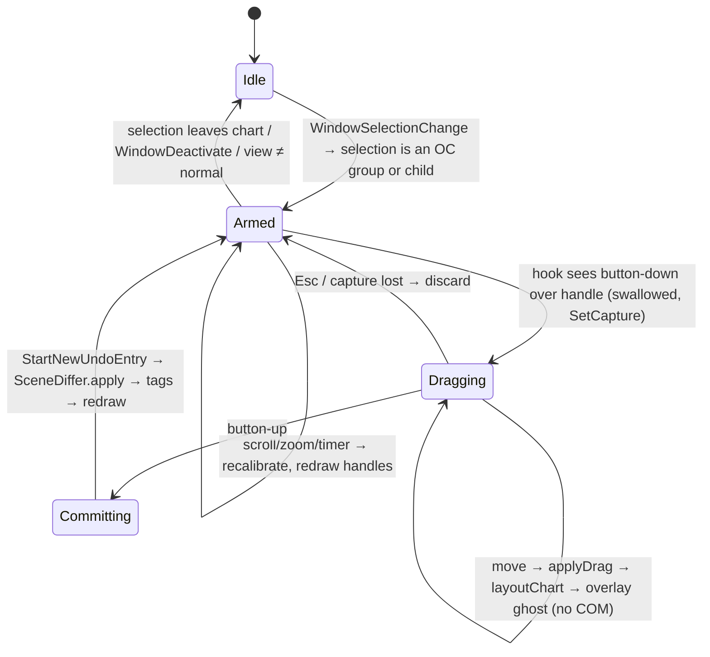

# Native Windows PowerPoint add-in — implementation design

Status: design draft. Companion to `docs/plan/03-officejs-and-mac.md` (the cross-platform Office.js add-in). This document covers the **Windows-only native COM add-in** whose reason to exist is *on-slide direct manipulation*: drag handles that change gaps, bar widths and label positions, right-click menus on chart parts, and live re-layout while dragging. Everything an Office.js add-in can do (insert, datasheet, update) is reused, not redesigned.

Sources: this design draws on Microsoft documentation (PowerPoint object model, Office Fluent UI/customUI, Win32, DirectWrite, .NET COM interop), general Windows engineering practice, and inspiration from the reference product and other information available on the internet. Claims marked ⚠️ are *believed* true and must be verified by the named spike (§10) before the design relies on them.

## 0. One-paragraph summary

A C# (.NET Framework 4.8) shared COM add-in, registered per user under HKCU, loads in-process into PowerPoint, runs the existing TypeScript engine unmodified in an embedded JS interpreter (Jint) with text metrics from the engine's own opentype.js code reading `C:\Windows\Fonts`, writes charts as the same tagged group of plain shapes the CLI writes, and edits them *in place* (diff by role, never delete-and-recreate on the hot path). Direct manipulation is a transparent layered overlay window that draws handles over the slide pane and a thread-local message hook that intercepts mouse-down on a handle, previews the new layout in the overlay during the drag (no COM calls), and commits one in-place update in one undo entry on mouse-up. A WebView2 task pane hosts the existing `src/web/editor.html` datasheet.

```
┌───────────────────────── PowerPoint.exe (one STA UI thread) ──────────────────────────┐
│  Ribbon/customUI ──▶ Connect (IDTExtensibility2, IRibbonExtensibility, ICTPConsumer)  │
│                            │                                                           │
│   ┌──── Engine host ───────┼──────────────┐    ┌──── Slide I/O ───────────────────┐    │
│   │ Jint ◀── engine.js (esbuild bundle)   │    │ SceneWriter: scene → Shapes      │    │
│   │ Measurer: opentype.js / DirectWrite   │◀──▶│ SceneDiffer: role-keyed update   │    │
│   │ layoutChart(spec, frame) → Scene      │    │ ChartStore: Tags (OC_SPEC…)      │    │
│   └───────────────────────────────────────┘    └──────────────────────────────────┘    │
│                            │                                                           │
│   ┌──── Direct manipulation ──────────────────────────────────────────────────────┐    │
│   │ Calibrator (points⇄px) · HitTester (scene+handles) · Overlay (layered HWND)   │    │
│   │ InputHook (WH_GETMESSAGE, thread) · DragSession (preview → commit)            │    │
│   └───────────────────────────────────────────────────────────────────────────────┘    │
│   WebView2 task pane: src/web/editor.html (datasheet)   ·   Updater/crash-report stub  │
└────────────────────────────────────────────────────────────────────────────────────────┘
```

## 1. Add-in type and language

| Option | Load time | Crash isolation | Bitness | Runtime deployment | Verdict |
|---|---|---|---|---|---|
| C++ ATL COM add-in | best (~20 ms) | none (in-proc) | two builds (x86+x64) | none | Fastest, but every UI/engine piece costs 2–3× dev time; no managed JS interpreter |
| **C# .NET Framework 4.8 shared COM add-in** | CLR warm-up 150–300 ms (shared with other .NET add-ins) | none; one CLR, default AppDomain shared with other Fx add-ins unless shimmed | AnyCPU, one build | .NET Fx 4.8 is inbox on Win10/11 — nothing to install | **Recommended** |
| C# .NET 8 + `EnableComHosting` (comhost) | similar | none; ⚠️ only one .NET (Core) major version loads per process — if another add-in loaded .NET 6/7 first, ours may fail to activate | AnyCPU, but comhost is per-arch | needs .NET 8 Desktop Runtime (self-contained COM hosting ⚠️ unsupported last time checked) | Not now; revisit when Office itself ships a .NET (Core) host |
| VSTO (C#) | +VSTO runtime, +AppDomain per add-in | AppDomain isolation | AnyCPU | VSTO runtime + ClickOnce/MSI; VSTO is in maintenance mode | No: extra runtime, ClickOnce friction, no benefit for overlay/hook code |

Decision: **C# / .NET Framework 4.8, "shared add-in" style** (plain `[ComVisible]` class implementing `IDTExtensibility2`, `IRibbonExtensibility`, `ICustomTaskPaneConsumer`), no VSTO, no WinForms designer, P/Invoke for Win32. No in-process crash isolation exists for any COM add-in, so correctness discipline (§8) replaces isolation. If AppDomain isolation from other Fx add-ins is ever needed, add a 40-line C++ shim DLL that hosts the CLR in its own AppDomain (the public "COM shim" pattern); not in v1.

## 2. Reusing the engine

Three ways to run `src/core`: embed JS, port to C#, or call Node. Calling Node is out (process spawn, deployment). Porting duplicates a moving target. Embedding keeps one source of truth, which matters because layout rules will keep changing.

| JS host | Native deps | Perf (layout of 250-shape chart) | Notes |
|---|---|---|---|
| **Jint** (pure .NET interpreter) | none, AnyCPU | ⚠️ est. 5–30 ms (10× V8) — S4 measures | ES2023-ish; simplest to ship; no isolation issues |
| ClearScript + V8 | V8 ~30 MB ×2 (x86, x64) | ~1 ms | Fast; doubles installer, native DLL per bitness, load-time cost |
| QuickJS via .NET binding | small native lib ×2 | ~3 ms | Bindings less mature; same bitness tax |

Decision: **Jint**, with ClearScript/V8 as the drop-in fallback if S4 shows drag re-layout can't hit ~30 ms (handle drags re-run layout at most every animation frame; 30 ms = 33 fps is enough with input coalescing).

Build: `esbuild src/core/index.ts --bundle --format=iife --global-name=OC --target=es2020` → `engine.js` embedded as a resource. The engine's only I/O is `text.ts` (reads font files). Expose `createMeasurer` from a `.NET`-provided object instead: the engine already takes `Measurer` as a parameter, so the host passes `{ width(text,size,bold), lineHeight(size) }` implemented in C#.

**Font measurement.** PowerPoint 2013+ renders text through DirectWrite; the widths it lays out with are the font's design advances (unhinted, fractional), which is exactly what opentype.js `getAdvanceWidth` returns from `hmtx`. GDI `GetTextExtentPoint32` returns hinted, pixel-snapped widths at one DPI — wrong for layout. Plan:
1. v1: keep `vendor/opentype.module.js` inside the bundle; C# reads the font bytes (Arial, or theme font resolved via `HKLM\SOFTWARE\Microsoft\Windows NT\CurrentVersion\Fonts` + `HKCU\…\Fonts` for per-user fonts) and hands an `ArrayBuffer` to the engine. Zero new measuring code; byte-identical scenes with the CLI.
2. v1.1: DirectWrite measurer (`IDWriteFactory` → `IDWriteFontCollection` by family name → `IDWriteFontFace::GetDesignGlyphMetrics`, or `IDWriteTextLayout::GetMetrics` at 96 DPI with `DWRITE_MEASURING_MODE_NATURAL`) so any installed family/weight works, including collections (.ttc) and variable fonts opentype.js handles poorly. Via a tiny C++/CLI or `Vortice.DirectWrite`.
3. Line height: the engine uses `1.2 × size`; PowerPoint uses the font's own line metrics (Arial ≈ 1.15). S9 compares both measurers against `TextRange2.BoundWidth/BoundHeight` on 50 strings and fixes the constant per family if needed.

**Host ↔ engine interface** (the only surface the C# side depends on; stable across engine versions):

```ts
// exported from the esbuild bundle as globalThis.OC
layoutChart(spec: ChartSpec, frame: Frame, m: Measurer, style?: Style): Scene
checkScene(scene: Scene): { ok: boolean; problems: string[] }
handlesFor(scene: Scene, spec: ChartSpec): Handle[]        // new, src/core/handles.ts (pure, shared with web add-in)
applyDrag(spec: ChartSpec, h: Handle, dxPt: number, dyPt: number): ChartSpec   // new, pure
```

`handlesFor`/`applyDrag` live in `src/core` rather than C# so the handle geometry and the drag → spec mapping are testable in Node and identical in the Office.js add-in's SVG preview later. Examples of `applyDrag`: gap handle between columns `i, i+1` with column width `w` and gap `g·w`: `gap' = clamp((g·w + dx·k) / w, 0.05, 3)` where `k = n_gaps_right_of_handle / n_gaps` keeps the dragged edge under the cursor; label handle: `labelOffsets[role] = {dx: dx0+dx, dy: dy0+dy}` snapped to `inside/above/below` slots when within 3 pt, else free. Every scene also carries `roles: string[]` parallel to `shapes` (one-line change to `common.ts`), which is what the tag writer and differ key on.

## 3. Chart identity and storage

**Identity and storage follow tag contract v1 in `docs/plan/03-officejs-and-mac.md` §4.3 verbatim** — it is the single interop format for the CLI writer, the Office.js add-in and this add-in; this document defines no second scheme. Recap (group tags unless noted): `OC_V` contract version (`"1"`), `OC_ENGINE` engine version (migrations), `OC_SPEC` compact JSON spec + style overrides (chunked `OC_SPEC_0…n` + `OC_SPEC_N` over the size limit), `OC_FRAME` `"x,y,w,h"` pt, `OC_FONT`, `OC_HIDDEN` roles the user deleted, and `OC_ROLE` on every child (`bar:s1:c2`, `label:value:s1:c2`, `axis`, `arrow:cagr`, …). Native reads them through `Shape.Tags.Item(name)` and writes through `Tags.Add` (PowerPoint upper-cases names; values are strings). Tags live in `p:custDataLst` → `ppt/tags/tagN.xml`, survive copy/paste and are invisible to users. Group `Name` stays human, `AlternativeText` stays prose. Why tags and not the alternatives: `CustomXMLParts` are presentation-level with no stable per-shape key (shape IDs change on paste); names are user-editable and length-limited.

Reading rules: `OC_V` > 1 → chart is read-only in this add-in (banner: "made with a newer open-charts"); `OC_ENGINE` older than ours → migrate the spec on first edit and rewrite `OC_ENGINE`; `OC_FRAME` ≠ current group bounds → the user resized/moved natively, offer/perform re-layout (§3 re-render, §4.5).

**Extensions native needs** (proposed as contract v1 additions — additive, ignorable by other hosts, to be merged into §4.3 of the plan):

| Key | On | Value | Why native needs it |
|---|---|---|---|
| `OC_BASE` | group | JSON `{role: {fill?, size?, bold?, color?}}` — the *last rendered* value of override-able properties per role | three-way merge in the in-place differ (below): detects user formatting overrides without a full rebuild. The web add-in's §4.6 "read back common manual edits before deletion" can use the same key |
| `OC_LINK` | group | JSON `{path, sheet, range\|name, hash}` | Excel link (M7); other hosts ignore it |
| spec fields, not tags | in `OC_SPEC.options` | `labelOffsets: {role: {dx,dy}}`, `arrowLevel`, `axisMax` | written by drag handles; plain `ChartOptions` additions in `src/core`, so CLI and web honour them |
| `Scene.roles` | engine output, not a tag | `string[]` parallel to `shapes` | the engine, not each host, decides roles; one-line change in `common.ts`; the CLI writer and web add-in need it too to emit `OC_ROLE` |

⚠️ Tag value size limit is undocumented; the plan's S2 and this doc's S6 measure it (same spike, run once). No new size risk from `OC_BASE`: ≈ 40 bytes × roles ≈ 10 KB for a 250-shape chart; chunk like `OC_SPEC` if needed.

**Re-render strategy: in-place diff, never delete-and-recreate on the hot path.**

```
new scene (role → shape)      current group items (OC_ROLE → Shape)       OC_BASE (role → last rendered)
        └──────────────┬──────────────────┘                                      │
                       ▼                                                         │
   for each role:  geometry  → set Left/Top/Width/Height only if changed (EMU-rounded compare)
                   text      → set TextRange.Text only if changed
                   fill/font → if current == OC_BASE (not touched by user) set new; else keep user's value,
                               record it in OC_SPEC as an override (series.color, label hidden, …)
   missing roles → create inside group;   extra roles → delete;   then OC_BASE := new scene
```

- Geometry/text edits on group children work through `group.GroupItems(i)` without ungrouping (⚠️ S5 confirms all needed properties are settable on group items; known to work for position/size/text/fill in 2010+).
- Adding or removing children (series/category count changed) requires `Ungroup()` → edit `ShapeRange` → `Group()`. That creates a new group shape (new ID, lost tags, top z-order), so the writer: records `ZOrderPosition`, name, alt text, tags before; re-applies after; restores z-order by `ZOrder(msoSendBackward)` N times. Rare path, acceptable.
- Z-order inside the group follows scene order; the differ only calls `ZOrder` when a role's relative order changed (rare: label moved above/below a bar).
- Frame: the group's *current* `Left/Top/Width/Height` is the frame — the user resizes or moves the group natively, we re-plan into the new frame (`WindowSelectionChange` + bounds compare, or `AfterShapeSizeChange` ⚠️ exists in the PowerPoint 2010+ event set).

## 4. Direct manipulation

### 4.1 What PowerPoint gives us, and the gaps
Documented events on `Application` (sink via `EApplication` connection point): `WindowSelectionChange(Selection)`, `WindowBeforeRightClick(Selection, ref Cancel)`, `WindowBeforeDoubleClick`, `SlideSelectionChanged`, `WindowActivate/Deactivate`, `AfterShapeSizeChange(Shape)` ⚠️, `PresentationSave/Close`, `NewPresentation`. There is **no** mouse-move, mouse-down, drag, scroll or zoom event, and no per-shape HWND: the whole slide is one window. Hence Win32 below.

Selection semantics we can rely on: clicking a group selects the group; a second click selects a child (`Selection.HasChildShapeRange`, `Selection.ChildShapeRange`, `Shape.ParentGroup`). Right-click selects the shape under the cursor before `WindowBeforeRightClick` fires ⚠️ (S8). That alone gives *element identity* for context menus and for handle display without any hook.

### 4.2 Coordinate mapping
`DocumentWindow.PointsToScreenPixelsX(pts)` / `PointsToScreenPixelsY(pts)` map slide points → screen pixels for the active view, including zoom and scroll. There is no documented inverse ⚠️, so the **Calibrator** samples two points per axis (0 and 720 pt) and inverts the affine map. Invariants it must handle:
- **Zoom/scroll**: no event. Recalibrate on every mouse-down, on `WM_MOUSEWHEEL`/`WM_VSCROLL`/`WM_HSCROLL` seen by the hook, and on a 150 ms idle timer while a chart is selected (compare `View.Zoom` and the two sample points; cheap).
- **DPI / multi-monitor**: PowerPoint is per-monitor-DPI-aware (v2). ⚠️ The returned pixels are expected to be physical screen pixels (S2 checks at 100/150/200 % and on a mixed-DPI pair). The overlay is a raw Win32 window placed in physical screen coordinates, so no WPF/WinForms scaling layer can get it wrong. Our DLL inherits the host's DPI awareness context; never call `SetProcessDpiAwareness*`.
- **View type**: only `ppViewNormal`/`ppViewSlide` with the slide pane visible; otherwise handles are hidden. Multiple document windows: one calibrator per `DocumentWindow`.

### 4.3 Overlay
One `WS_POPUP | WS_EX_LAYERED | WS_EX_TRANSPARENT | WS_EX_TOOLWINDOW | WS_EX_NOACTIVATE` window per document window, **owned by** PowerPoint's main HWND (`Application.HWND`) so it stays above its owner and minimises/z-orders with it, without `TOPMOST`. Drawn with `UpdateLayeredWindow` from a 32-bit premultiplied bitmap (GDI+ or Direct2D). `WS_EX_TRANSPARENT` means clicks fall through to PowerPoint; *we* decide what to intercept in the hook, which keeps PowerPoint's own click/drag/marquee behaviour intact everywhere except on our handles. Hidden on `WindowDeactivate`, on scroll/zoom until recalibrated, when the selection is not an open-charts chart, and during slide show.

Handle set (computed from the scene + roles, in points, then mapped):

| Handle | Where | Drag changes |
|---|---|---|
| Gap | midpoint between adjacent columns, at baseline | `options.gap` (constrained 0.05–3; live value shown in a tooltip) |
| Bar width | right edge of last column (and mekko segment edges) | `gap` via width (columns + gaps fill the frame) / mekko column share |
| Label | any `label:*` box | `labels[role].offset` (dx,dy in pt) or snap-slots `inside/outside/hidden` for value labels |
| Series label column | left edge of the right-hand series labels | `seriesLabelGap` |
| Arrow row | the CAGR/difference bracket line | `arrowLevel` |
| Axis break | value-axis top | axis max override |

New spec fields (`labelOffsets`, `arrowLevel`, axis overrides) are plain `ChartOptions` additions in `src/core`, so the CLI and web add-in honour them too.

### 4.4 Input: hook vs subclass
| Approach | How | Risks |
|---|---|---|
| **Thread-local `WH_GETMESSAGE` hook (recommended)** | `SetWindowsHookEx(WH_GETMESSAGE, proc, 0, GetCurrentThreadId())` from the UI thread; sees every posted message (`WM_LBUTTONDOWN/MOUSEMOVE/LBUTTONUP`, `WM_POINTER*`, `WM_MOUSEWHEEL`, `WM_KEYDOWN`) before PowerPoint; to swallow one, set `msg.message = WM_NULL` on `PM_REMOVE`. No DLL injection (same process/thread). | Hook proc must be fast (<0.2 ms) and never throw; keep the delegate alive; ⚠️ Office may consume `WM_POINTER*` and not generate legacy mouse messages — handle both families (S1 checks with Spy++ what the pane receives) |
| `WH_MOUSE` thread hook | simpler; returning nonzero eats the message | does not see `WM_POINTER*`; otherwise same |
| Subclass the slide pane (`SetWindowSubclass`) | find pane HWND by `EnumChildWindows(Application.HWND)` + class name | class names (`paneClassDC`…) are undocumented and may change; PowerPoint may re-create the pane; cleanest for `WM_SETCURSOR` though |
| Low-level `WH_MOUSE_LL` | global | needs its own thread + message pump, sees other apps' input, antivirus-sensitive — no |

The hook is installed only while an open-charts chart is selected and removed otherwise (zero cost 99 % of the time). `WM_SETCURSOR` for the resize cursors: handled by subclassing the pane *only* if S1 finds a stable class; otherwise `SetCursor` from the hook on `WM_MOUSEMOVE` over a handle (works, slightly flickery).

### 4.4b Lifecycle of the manipulation layer

Idle costs nothing: no hook, no overlay, no timer. Armed installs the hook and creates the overlay lazily (first time ≈ 5 ms). The `Armed → Idle` edge is the safety valve: any unexpected state (exception in hook, pane HWND gone, `Application.HWND` changed) tears everything down and logs; the user still has the ribbon/pane path.

### 4.5 Drag session
```
WM_LBUTTONDOWN over handle (hit-test in points, 6 px tolerance, handles win over shapes)
  → swallow message; SetCapture(overlay); Esc armed; record spec0, scene0
WM_MOUSEMOVE (coalesced to one per frame via a 16 ms timer)
  → delta px → pt; derive the spec change (gap = f(dx)); layoutChart(spec', frame) in Jint
  → overlay draws ghost: new bar outlines + label boxes (semi-transparent), live value tooltip
  → NO COM calls to PowerPoint during the drag
WM_LBUTTONUP / Esc
  → ReleaseCapture; swallow; Esc → discard
  → Application.StartNewUndoEntry(); SceneDiffer.apply(scene'); write OC_SPEC/OC_BASE; re-select the chart
```
Rationale for ghost-preview-only: a gap change moves every column and label (250 shapes × 4 props ≈ 1 000 COM calls ≈ 30–60 ms in-proc) — feasible per frame but it pollutes undo with hundreds of entries and fights PowerPoint's repaint. The ghost is cheaper and reads better. If S5 shows `StartNewUndoEntry` groups everything, a "live shapes" mode for *single-label* drags (4 calls/frame) can be added behind a setting.

Native drags still work: if the user moves/resizes a bar or label *with PowerPoint's own handles* (not ours), we interpret the result on `WindowSelectionChange`/`AfterShapeSizeChange`: a resized column → gap; a moved label → offset; a moved/resized group → new frame. This "interpret native edits" path is the **fallback for everything if hooks prove unstable on some builds** (§10 risk 1) and ships in M2 before the overlay exists.

### 4.6 Keyboard and accessibility
- With a handle "active" (clicked without dragging), the hook maps ←/→/↑/↓ (±1 pt; Shift ±10) and Esc/Enter; the active handle is drawn filled.
- Every handle has a non-pointer equivalent: contextual ribbon tab (§6) spinners for gap, label position menus, arrow level; all are keyboard-navigable Fluent controls with UIA names. The overlay itself is not exposed through UIA (it is a `WS_EX_TRANSPARENT` layered window); screen-reader users use ribbon/pane, and the chart's alt text is regenerated on each update ("Stacked column chart, 4 categories, 2 series, totals 60 to 122").
- High contrast: handle colours from `SystemColors`; overlay honours reduced-motion (no animated snapping).

## 5. Undo/redo, performance, threading
- **Undo.** `Application.StartNewUndoEntry()` marks the start of a new undo entry; ⚠️ OM changes made after it (until the next user action or call) are expected to collapse into that entry — S5 counts Ctrl+Z presses after a 250-shape in-place update and after an ungroup/regroup. Undo stack depth is a user option (default 20); one entry per commit keeps us well inside it. Our ghost preview creates no entries. Redo is PowerPoint's. We never call `ExecuteMso("Undo")` ourselves. The pane's "Revert last update" (previous spec in memory) is kept as belt-and-braces.
- **Performance.** In-process, same-thread COM calls cost ~3–20 µs; a full chart update is 500–1 500 calls (budget ≤ 100 ms, typical 30 ms). Rules: compare before set; batch text runs per shape (`TextRange.Text` once, then font once); never `Select()` shapes (triggers repaint and events); do not use `Shapes.Range` with names (string lookups); cache `GroupItems` enumeration into a role→Shape dictionary once per session and invalidate on `WindowSelectionChange`. PowerPoint has no `ScreenUpdating`; ⚠️ `WM_SETREDRAW` on the slide pane during the update is a possible flicker fix (S5), otherwise accept one repaint.
- **Threading.** All OM, hook and overlay work on PowerPoint's single UI STA thread; the hook *must* be installed from that thread. Jint runs synchronously there (fast enough per S4). Anything slow (font enumeration, update check, crash upload, Excel link refresh) runs on a worker thread and marshals back via a hidden message-only window (`PostMessage` + `SynchronizationContext`); OM objects are never touched off-thread (would be `RPC_E_WRONGTHREAD`/marshalling). No `DoEvents` anywhere.

## 6. Context menus and ribbon
- **Ribbon**: `IRibbonExtensibility.GetCustomUI("Microsoft.PowerPoint.Presentation")` returns customUI 2010 XML (`http://schemas.microsoft.com/office/2009/07/customui`). Own tab "Charts" (Insert · Data · Elements · Layout · Style · Help), plus a group added to `TabInsert`. A **chart tab that appears on selection** is a normal tab with `getVisible` toggled from `WindowSelectionChange` via `IRibbonUI.Invalidate` (custom contextual *tab sets* are not possible; adding groups to the built-in `TabSetDrawingTools` is). `getEnabled`/`getLabel` callbacks are invoked on invalidate, so keep them cheap (read cached selection state only).
- **Context menus**: customUI 2010 `<contextMenus>` lets us add controls to built-in menus by `idMso`: `ContextMenuShape`, `ContextMenuObjectsGroup`, `ContextMenuShapeConnector`, `ContextMenuTextEdit`, `ContextMenuShapeFreeform` (IDs from Microsoft's published Fluent UI control-identifier lists). We insert one `dynamicMenu` ("open-charts") whose `getContent` builds items for the clicked element (e.g. value label → "Hide label / Inside / Above / Reset position / Number format…"; bar → "Series colour…/ Move series up / Add difference arrow from here"). Element identity comes from `WindowBeforeRightClick` (selection already updated) plus the hook's last cursor position for hit-testing *handles* and empty areas. ⚠️ S8 confirms `WindowBeforeRightClick` precedes `getContent`. Limits: built-in items cannot be removed (only `insertBeforeMso` ordering), there's no way to open a *different* menu per element, and `Cancel = true` in `WindowBeforeRightClick` suppresses the whole menu — we may use that to show our own WPF context menu for *handles* only (not for shapes, so the user keeps PowerPoint's formatting items).

Per-element items (all also reachable from the contextual tab; every action is one `applyDrag`-style pure spec edit + one in-place update):

| Clicked element (role) | Items |
|---|---|
| `bar:*` / `marker:*` | Series colour… · Move series up/down · Show/hide value labels for series · Add difference arrow from here… · Add CAGR arrow from here… |
| `label:value:*` | Hide · Inside / Above / Below · Reset position · Decimals ▸ 0/1/2/auto · Unit… |
| `label:total:*` | Hide totals · Decimals ▸ · Bold on/off |
| `label:category:*` | Edit text (opens pane row) · Rotate 0°/45°/90° (later) · Hide |
| `axis` / `tick:*` | Show/hide axis · Axis max… · Zero-based on/off · Gridlines on/off (later) |
| `arrow:*` / `bubble:*` | Remove arrow · Move row up/down · Edit endpoints… |
| group (empty area) | Open datasheet · Re-layout to current size · Chart type ▸ · Gap… · Series labels ▸ right/legend/none · Convert to plain shapes (strips tags) |

- **Command repurposing**: `<commands><command idMso="ObjectsUngroup" onAction=…/>` warns when ungrouping a chart (and strips tags cleanly); `ObjectsRegroup` re-attaches; `Copy`/`Paste` untouched. Keep this list short — repurposed commands are a common cause of "the add-in broke my PowerPoint" reports.

## 7. Datasheet window and Excel links
- **Host**: `ICustomTaskPaneConsumer` → task pane (dockable, remembered position) containing a WinForms `UserControl` with **WebView2** showing `src/web/editor.html` from the install directory (`file://` or a virtual host via `SetVirtualHostNameToFolderMapping`). Reuses the existing grid/paste/preview UI; messages via `postMessage` ↔ `CoreWebView2.WebMessageReceived` (`{type:"spec", spec}` → add-in applies to the selected chart; add-in pushes `{type:"select", spec}` on selection change). Why WebView2: the runtime is Evergreen and already present wherever Office.js add-ins run (Office installs it); it gives us the grid for free and a path to share UI with the web add-in. Fallback if WebView2 is missing: show a message with the Evergreen bootstrapper link (no bundling of the 100 MB runtime).
- A floating "Datasheet" tool window (WPF `Window` with `Owner = Application.HWND`) is a 1-day variant for users who dislike docked panes; same WebView2 control.
- **Excel links (later)**: tag `OC_LINK` = `{path, sheet, range|name, lastHash}`; "Refresh from Excel" opens via `Excel.Application` (running instance from the ROT via `GetActiveObject`, else a hidden new instance) and reads `Range.Value2`; optional live mode subscribes to `Workbook.SheetChange` while both are open. No OLE embedding, no link in the .pptx beyond the tag.

## 8. Packaging, deployment, resilience
- **Per-user, no admin.** Installer (WiX per-user MSI, or a Velopack/Squirrel-style installer) copies to `%LOCALAPPDATA%\open-charts\app-<ver>\` and writes:
  `HKCU\Software\Classes\CLSID\{GUID}\InprocServer32` = `mscoree.dll`, `ThreadingModel=Both`, `Class`, `Assembly`, `RuntimeVersion=v4.0.30319`, `CodeBase=file:///…\OpenCharts.dll`; `ProgID`; and
  `HKCU\Software\Microsoft\Office\PowerPoint\Addins\OpenCharts.Connect` = `FriendlyName`, `Description`, `LoadBehavior=3`.
  No `regasm` (it writes HKLM by default). ⚠️ On 64-bit Windows, 32-bit Office reads per-user CLSIDs under `HKCU\Software\Classes\WOW6432Node\CLSID` — write both (S7).
- **Bitness**: AnyCPU managed assembly + Jint = one build for 32/64-bit Office. The only native pieces are optional (DirectWrite shim, WebView2 loader — ships x86+x64 and picks at runtime).
- **Signing**: Authenticode on every DLL and the installer (Azure Trusted Signing or an EV cert; OV certs face SmartScreen warnings until reputation builds). Strong-name not required.
- **Auto-update**: updater runs outside PowerPoint (scheduled on PowerPoint exit or a tray-less task): downloads delta, stages `app-<ver+1>`, flips `CodeBase`; the loaded DLL is locked, so updates apply on next launch. Never update while loaded.
- **Crash reporting**: every entry point (ribbon callbacks, event sinks, hook proc, timer ticks, WebView2 messages) is wrapped — an unhandled exception in a COM callback or hook procedure can take PowerPoint down. `AppDomain.UnhandledException` + `FirstChanceException` sampling → local log, opt-in upload with minidump-free, PII-free payload (Office build, add-in version, stack). Hook proc: `try { … } catch { return CallNextHookEx(...); }`, no allocation on the hot path.
- **Office add-in resiliency**: Office disables COM add-ins whose load time exceeds ~1 s (median over recent sessions) or that crash during load, and shows "Slow and disabled add-ins". Budget: `OnConnection` ≤ 150 ms — register events, return ribbon XML, nothing else. Jint, engine bundle, fonts, WebView2 and the hook are lazy (first click). Measure in File › Options › Add-ins. Enterprises can allow-list via `HKCU\Software\Microsoft\Office\16.0\PowerPoint\Resiliency\DoNotDisableAddinList` (document for IT). `LoadBehavior` flipping to 2 after a crash is detected by the installer/updater and repaired with user consent.

### 8.1 Failure containment rules (apply everywhere)
1. No exception crosses a COM boundary: every `[ComVisible]` method, event sink, ribbon callback and hook proc is `try { } catch (Exception e) { Log.Error(e); }` with a user-visible, non-modal error strip in the pane; never `MessageBox` from a hook or event (re-entrancy).
2. No OM call outside the UI thread; `Debug.Assert(Thread.CurrentThread.ManagedThreadId == uiThreadId)` in the OM adapter.
3. The hook is counted: install/uninstall are reference-counted and asserted balanced on `OnDisconnection`; `OnBeginShutdown` tears down overlay, hook, WebView2, Jint in that order.
4. A failed in-place update (e.g. a shape the user deleted mid-way, `COMException` 0x800A01A8 "object deleted") falls back once to full rebuild (ungroup-free: delete group, write new, restore z-order), still inside the same undo entry.
5. Tag writes are last: a chart whose shapes updated but whose `OC_SPEC` didn't is self-healing (next selection re-derives from `OC_BASE` + current shapes); a chart whose tags updated but shapes didn't would not be, so order matters.
6. Feature flags in `HKCU\Software\open-charts\Flags` (overlay, hook, liveShapes, directWrite) so support can switch a layer off per machine without an update.

## 9. Testing
- **Engine**: unchanged Node tests; plus a parity test that runs the same spec in Jint (C# test project) and in Node and asserts byte-identical scene JSON.
- **Writer/differ**: `SceneWriter` and `SceneDiffer` target a 6-method interface (`AddRect/AddLine/AddText/SetProps/Delete/Group`); a recording fake checks the call sequence and count per example chart; the real adapter is thin.
- **Automation tests** (CI on a Windows VM with Office): a test runner starts `PowerPoint.Application` out-of-process, loads the add-in (`COMAddIns["OpenCharts.Connect"].Connect = true`), and drives it through `COMAddIn.Object` (the add-in exposes a small test interface: insert spec, update spec, simulate drag(role, dx, dy), undo count). Assertions via OM: shape count, tags, bounds; then `Slide.Export(png, 1920)` → **golden images** against the SVG renderer rasterised, with a per-pixel tolerance and a labelled-diff artefact. Also round-trip: CLI `.pptx` → open → update → save → XML-normalised diff shows only expected changes.
- **Input tests**: a small FlaUI/`SendInput` smoke suite for handle drag, right-click menu and Esc, run on 100 % and 150 % DPI VMs; kept small because they're inherently flaky.
- **QA matrix**: Office 2016 / 2019 / 2021 / 2024 perpetual + Microsoft 365 Current and Semi-Annual channels; 32- and 64-bit; Windows 10 22H2 and 11; DPI 100/150/200 and mixed two-monitor; another .NET add-in present; a corporate template deck with a theme font other than Arial.

## 10. Milestones, risks, spikes

Estimates for one strong Windows developer, ±30 %. Total ≈ 22 weeks to a public beta.

| # | Milestone | Deliverable | Est. |
|---|---|---|---|
| 0 | Spikes | Go/no-go on hook, calibration, Jint, undo, tags; written results | 2 w |
| 1 | Skeleton | Add-in loads < 150 ms, ribbon tab, Jint engine + opentype measurer, insert chart on current slide as tagged group; tags also emitted by `src/render/pptx.ts` | 3 w |
| 2 | Edit in place | Selection → spec; WebView2 datasheet; `SceneDiffer` with three-way override merge; "interpret native edits" re-layout; one undo entry per update | 3 w |
| 3 | Direct manipulation | Calibrator, overlay handles, `WH_GETMESSAGE` hook, drag sessions for gap/width/labels with ghost preview and commit; keyboard | 5 w |
| 4 | Menus & polish | Context-menu items per element, repurposed Ungroup/Regroup, contextual tab, high-DPI/multi-monitor hardening | 2 w |
| 5 | Ship | Per-user installer, signing, updater, crash reporting, resiliency allow-list docs | 3 w |
| 6 | Quality | Automation harness, goldens, QA matrix pass, private beta fixes | 3 w |
| 7 | Later | DirectWrite measurer, Excel links, more handle types | +4 w |

**Top 5 risks**
1. *Input interception is fragile across Office builds* (pointer vs mouse messages, pane re-creation, undocumented class names). Mitigation: hook only while a chart is selected; the "interpret native edits" path (M2) is a complete fallback; feature flag to disable the overlay per Office build.
2. *Coordinate mapping errors* (DPI, mixed monitors, zoom/scroll without events) produce handles that are off by pixels and feel broken. Mitigation: calibrate on every mouse-down, hide-on-scroll, S2 across the DPI matrix, visible debug overlay.
3. *Undo granularity*: if `StartNewUndoEntry` doesn't group OM changes, one drag = hundreds of Ctrl+Z steps. Mitigation: S5 first; otherwise minimise calls (differ) and provide in-pane Revert; document honestly.
4. *Group-item editing limits* force ungroup/regroup on common paths, which loses tags/z-order and flickers. Mitigation: S5; keep child set stable (hidden labels become zero-size, not deleted) so regroup is only for series/category count changes.
5. *Load-time/resiliency and host co-tenancy*: a slow start or a crash in a hook proc gets the add-in disabled or takes PowerPoint down. Mitigation: lazy everything, exception walls, load-time measured in CI, no native runtime dependencies.

**Spikes, weeks 1–2** (each is a throwaway project; results go in `docs/plan/spike-results.md`)

| ID | Question | Method | Exit |
|---|---|---|---|
| S1 | Can a thread `WH_GETMESSAGE` hook see and swallow mouse-down on the slide pane? Which messages (mouse vs `WM_POINTER*`) arrive? Stable pane class name? | Minimal add-in; Spy++ on 2016 and M365; eat `WM_LBUTTONDOWN` inside a rectangle and SetCapture an overlay | Hook strategy fixed; subclass needed or not |
| S2 | Are `PointsToScreenPixelsX/Y` physical pixels, correct at 100/150/200 %, mixed monitors, after zoom/scroll? Inverse by calibration accurate to < 1 px? | Draw a crosshair overlay at (0,0)/(720,405) pt and compare with the rendered slide corner | Calibrator spec; DPI caveats listed |
| S3 | Layered, owned, non-activating overlay: stays above the pane, never steals focus, survives minimise/restore, multi-window | Prototype overlay with GDI+ handles | Overlay window style fixed |
| S4 | Jint: run `engine.js` + opentype.js on a 250-shape chart; time per layout cold/warm; memory | Console harness | ≤ 30 ms warm → Jint; else ClearScript |
| S5 | `GroupItems` edits of position/size/text/fill without ungroup; `StartNewUndoEntry` grouping; `WM_SETREDRAW` flicker; regroup z-order restore | Script 250-shape update, count Ctrl+Z | Differ rules and undo story confirmed |
| S6 | Tag size limit and persistence; survives copy/paste, Keynote/LibreOffice re-save | Write 1/32/256 KB tags | Storage strategy fixed |
| S7 | HKCU registration incl. WOW6432Node for 32-bit Office; cold-start `OnConnection` time of the Fx skeleton | Register on 32- and 64-bit Office VMs; read Office's add-in load-time dialog | Install script + load budget met |
| S8 | `WindowBeforeRightClick` fires before `dynamicMenu.getContent`; `ContextMenuObjectsGroup` vs child selection; `Cancel` behaviour | customUI prototype | Context-menu design confirmed |
| S9 | opentype.js advances vs PowerPoint `TextRange2.BoundWidth` for Arial/Calibri at 10–18 pt; line height constant | 50 strings, table of deltas | Measurer parity numbers; DirectWrite needed or not |

Spike order: S1 → S2 → S3 first (they decide whether direct manipulation is viable as designed), S4/S5 in parallel, the rest by the end of week 2.
